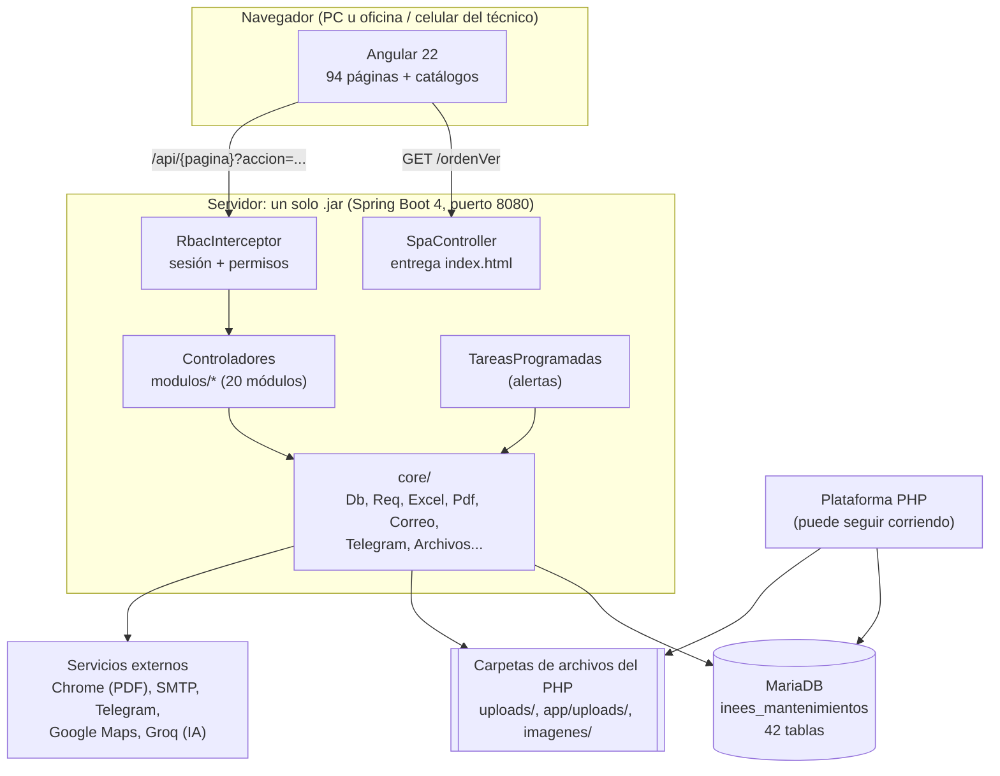

# 1. Visión general

INEES Mantenimientos es la plataforma con la que INEES programa, ejecuta, controla y factura los mantenimientos de máquinas (recicladores y dispensadores de efectivo) instaladas en los puntos de sus clientes. Esta versión está hecha en **Spring Boot (Java 21) + Angular 22** y reemplaza a la versión PHP, usando **la misma base de datos MariaDB `inees_mantenimientos`** y las mismas carpetas de archivos.

## Qué hace la plataforma

| Área | Qué permite | Quién la usa |
| --- | --- | --- |
| Catálogos y maestros | Clientes, puntos, máquinas, delegaciones, municipios, técnicos, tipos de mantenimiento y de máquina, repuestos, tarifas, festivos, novedades | Administración |
| Programación | Armar las rutas diarias por técnico, consolidado de lo programado, mapa de puntos, planeación estratégica (Gantt) | Administración, supervisor |
| Ejecución en campo | El técnico marca entrada, ve su programación, inicia el servicio con GPS, cronometra, reporta fotos, firma, repuestos y novedades | Técnicos |
| Control | Panel del supervisor en tiempo real, monitoreo del cronómetro, rastreo, alertas por Telegram y correo | Supervisor, administración |
| Inventario y remisiones | Remisiones asignadas a técnicos, stock por técnico, devoluciones, solicitudes de inventario | Administración, técnicos |
| Reportes | Tablero ejecutivo, PDF ejecutivo, facturación, servicios por técnico, historiales, trazabilidad, PDFs de servicios | Administración, cliente (Prosegur) |
| Administrativo | Horas extra, parqueaderos, transportes, costos, turnos, procesador de asistencia (huellero) | Administración, técnicos |
| Cargas masivas | Importar Excel de instalaciones, estado de máquinas, municipios y cargas iniciales por CSV | Administración |

El detalle de cada módulo está en [09-modulos.md](09-modulos.md).

## Arquitectura



Puntos clave del diseño:

1. **Un solo proceso.** Angular se compila dentro del backend (`backend/src/main/resources/static`) y Spring Boot sirve las páginas, la API y los archivos. En producción solo se ejecuta `java -jar`.
2. **Misma base y mismos archivos que el PHP.** No se cambió ninguna tabla. Las fotos y documentos se guardan en las mismas carpetas y con las mismas rutas relativas que guardaba el PHP. Las dos versiones pueden convivir.
3. **Misma API que el PHP, en forma REST sencilla.** Lo que en PHP era `index.php?pagina=X&accion=Y` ahora es `/api/X?accion=Y`, con las mismas claves en las respuestas JSON.
4. **Mismos permisos.** Las tablas `rutas` y `rol_permisos` deciden qué página ve cada rol, igual que antes.
5. **SQL a mano, sin ORM.** Las consultas son las mismas del PHP, escritas con `JdbcTemplate` mediante la clase `core/Db`. No hay entidades JPA.

## Tecnologías

| Capa | Tecnología | Versión |
| --- | --- | --- |
| Lenguaje backend | Java | 21 |
| Framework backend | Spring Boot (web MVC, JDBC, Mail) | 4.1.2 |
| Base de datos | MariaDB (compatible MySQL) con `mariadb-java-client` | 10.11 en local |
| Excel | Apache POI (`poi-ooxml`) | ver `pom.xml` |
| PDF | Chrome sin ventana (headless); respaldo OpenHTMLtoPDF | — |
| Contraseñas | `spring-security-crypto` (bcrypt compatible con PHP) | — |
| Frontend | Angular (componentes *standalone*) + TypeScript | 22 |
| Estilos | Tailwind CSS 3 + Font Awesome 6 | — |
| Librerías de pantalla | Chart.js, Leaflet, frappe-gantt, flatpickr, SweetAlert2, xlsx (SheetJS), pdfmake | ver `package.json` |
| Construcción | Maven (backend), Angular CLI / npm (frontend) | — |

## Estructura de carpetas

```text
ProyectoMantenimientos/                 ← raíz del proyecto PHP (LEGACY_ROOT)
├── app/, index.php, ...                ← plataforma PHP original (sigue intacta)
├── uploads/, app/uploads/, imagenes/   ← archivos subidos (compartidos con Java)
└── nueva-plataforma/
    ├── iniciar-local.bat               ← arranca todo en local
    ├── detener-local.bat               ← detiene todo
    ├── config-local.ejemplo.bat        ← plantilla de configuración local
    ├── scripts/                        ← ventanas auxiliares que usa iniciar-local.bat
    ├── documentacion/                  ← esta documentación
    ├── backend/                        ← Spring Boot
    │   ├── pom.xml
    │   ├── mvn-local.ps1               ← Maven con el JDK local (opcional)
    │   └── src/main/
    │       ├── java/co/inees/mantenimientos/
    │       │   ├── InneesApplication.java
    │       │   ├── core/               ← infraestructura común (ver 04-backend.md)
    │       │   └── modulos/<módulo>/   ← un paquete por módulo funcional
    │       └── resources/
    │           ├── application.yml     ← configuración
    │           ├── plantillas/         ← HTML/CSS de los PDF
    │           └── static/             ← Angular compilado (lo genera ng build)
    └── frontend/                       ← Angular
        ├── angular.json, package.json, proxy.conf.json, tailwind.config.js
        ├── public/                     ← archivos copiados tal cual (logos, js/asistencia)
        └── src/app/
            ├── app.routes.ts           ← todas las rutas
            ├── core/                   ← api, auth, guards, ui
            ├── layout/                 ← marco, menú por rol, modal de turno
            ├── shared/                 ← tabla, select con búsqueda, notificaciones
            └── paginas/<módulo>/       ← una o más pantallas por módulo
```

## Glosario

| Término | Significado |
| --- | --- |
| Página | Nombre lógico de una pantalla, igual al `nombre_ruta` de la tabla `rutas` (por ejemplo `ordenVer`). Es a la vez la ruta de Angular y el primer segmento de la API. |
| Acción | Operación dentro de una página, enviada como `?accion=` (por ejemplo `ajaxListar`, `guardar`). `index` trae los datos iniciales. |
| Punto | Sitio del cliente donde hay máquinas (tabla `punto`). |
| Máquina | Equipo identificado por `device_id` (tabla `maquina`). |
| Orden de servicio | Una visita a una máquina (`ordenes_servicio`): programada (estado 2), realizada (1) o anulada (0). |
| Remisión | Documento numerado que el técnico entrega en cada servicio (`control_remisiones`). |
| Delegación | Sede o zona operativa (Bogotá, Medellín, …). Define si un servicio es urbano o interurbano. |
| Legacy root | La carpeta raíz del proyecto PHP, desde donde Java lee y escribe los archivos subidos. |
