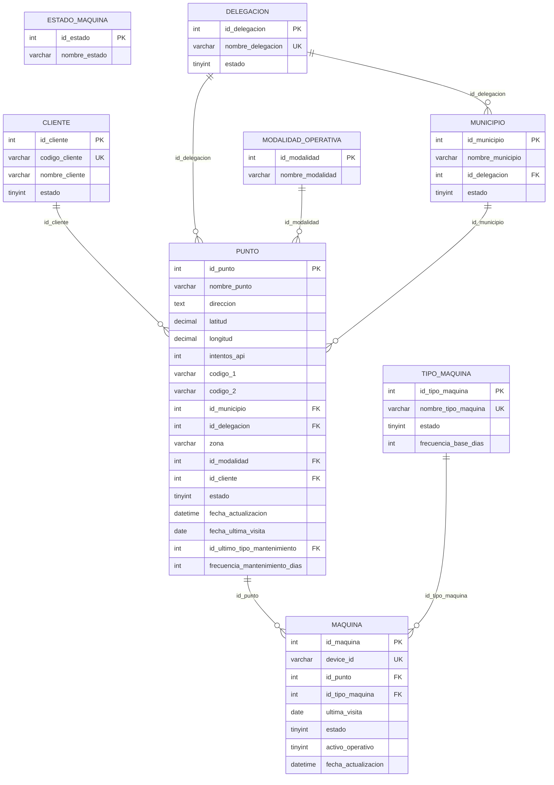
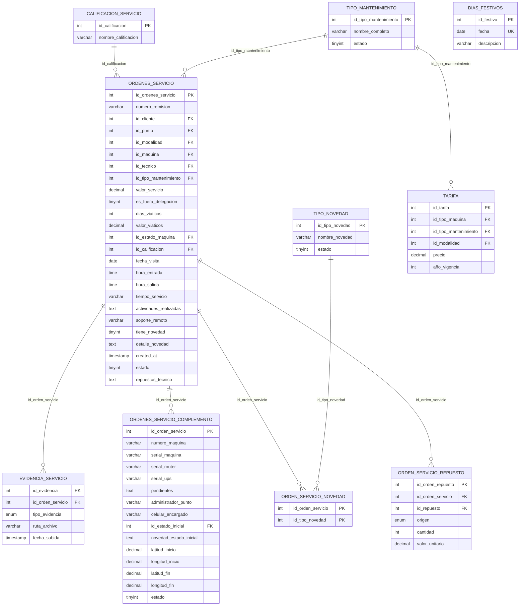
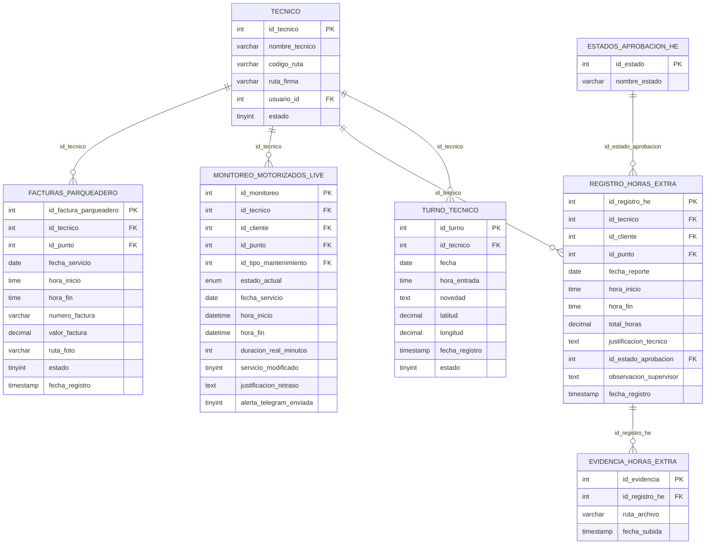
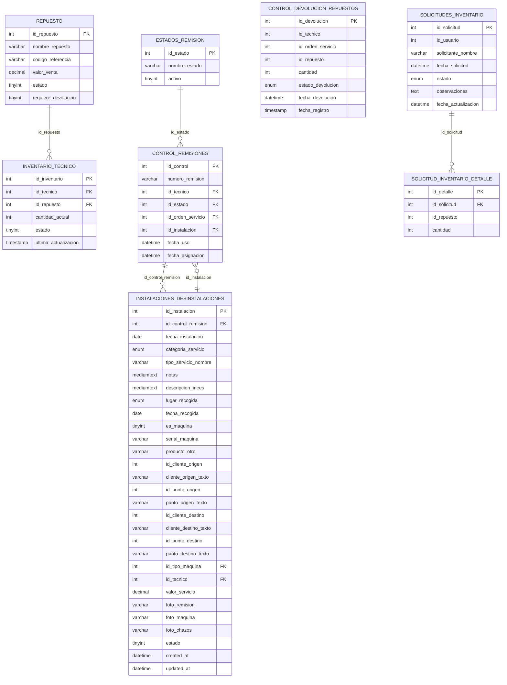
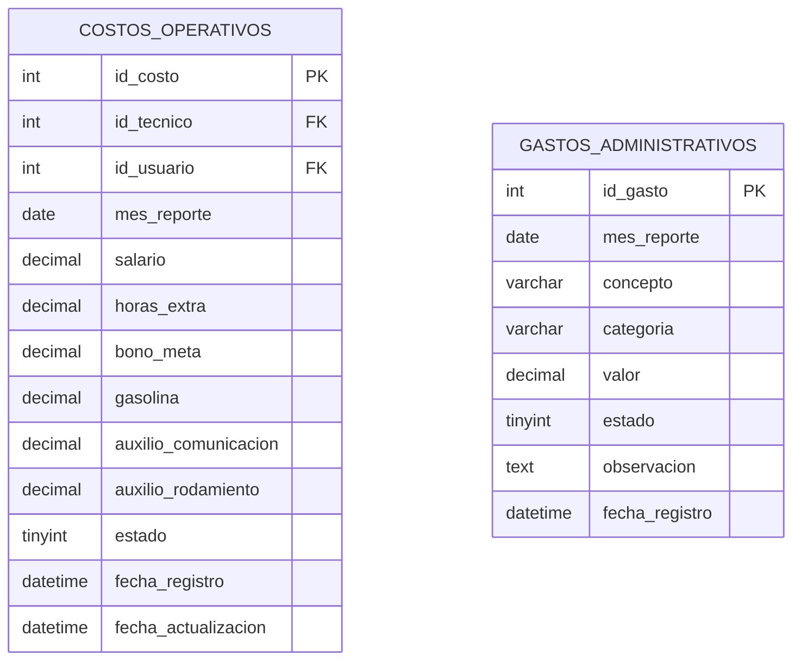
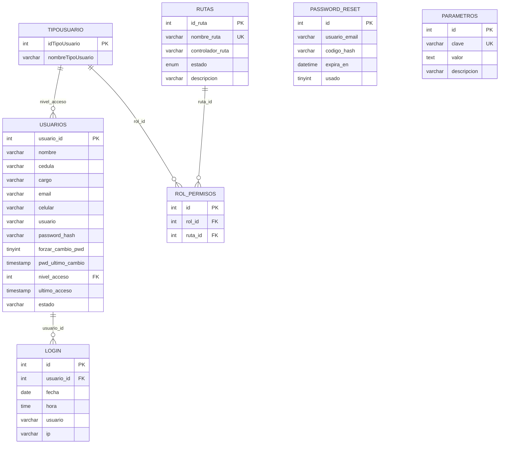

# 6. Base de datos

La plataforma usa la base MariaDB/MySQL **inees_mantenimientos**: 42 tablas y 55 llaves foráneas. Es la misma base que usa la versión PHP; la migración no cambió el esquema.

> Este documento se generó leyendo `information_schema` de la base local. Las cantidades de filas son aproximadas (estimación de InnoDB) y sirven solo como referencia de tamaño. Para regenerarlo después de un cambio de esquema, ver la sección [Regenerar este documento](#regenerar-este-documento).

## Contenido

- [Diagrama entidad-relación general](#diagrama-entidad-relación-general)
- [Diagramas por dominio](#diagramas-por-dominio)
- [Diccionario de datos](#diccionario-de-datos)
- [Valores y convenciones importantes](#valores-y-convenciones-importantes)
- [Regenerar este documento](#regenerar-este-documento)

## Diagrama entidad-relación general

Todas las tablas con sus llaves foráneas. Cada línea va de la tabla que guarda la llave (muchos) a la tabla referenciada (uno). Se ve con cualquier visor de Markdown que soporte Mermaid (GitHub, GitLab, VS Code con la extensión *Markdown Preview Mermaid Support*).

```mermaid
erDiagram
    ESTADOS_REMISION ||--o{ CONTROL_REMISIONES : "id_estado"
    INSTALACIONES_DESINSTALACIONES ||--o{ CONTROL_REMISIONES : "id_instalacion"
    ORDENES_SERVICIO ||--o{ CONTROL_REMISIONES : "id_orden_servicio"
    TECNICO ||--o{ CONTROL_REMISIONES : "id_tecnico"
    TECNICO ||--o{ COSTOS_OPERATIVOS : "id_tecnico"
    USUARIOS ||--o{ COSTOS_OPERATIVOS : "id_usuario"
    REGISTRO_HORAS_EXTRA ||--o{ EVIDENCIA_HORAS_EXTRA : "id_registro_he"
    ORDENES_SERVICIO ||--o{ EVIDENCIA_SERVICIO : "id_orden_servicio"
    PUNTO ||--o{ FACTURAS_PARQUEADERO : "id_punto"
    TECNICO ||--o{ FACTURAS_PARQUEADERO : "id_tecnico"
    CONTROL_REMISIONES ||--o{ INSTALACIONES_DESINSTALACIONES : "id_control_remision"
    TECNICO ||--o{ INSTALACIONES_DESINSTALACIONES : "id_tecnico"
    TIPO_MAQUINA ||--o{ INSTALACIONES_DESINSTALACIONES : "id_tipo_maquina"
    REPUESTO ||--o{ INVENTARIO_TECNICO : "id_repuesto"
    TECNICO ||--o{ INVENTARIO_TECNICO : "id_tecnico"
    USUARIOS ||--o{ LOGIN : "usuario_id"
    PUNTO ||--o{ MAQUINA : "id_punto"
    TIPO_MAQUINA ||--o{ MAQUINA : "id_tipo_maquina"
    CLIENTE ||--o{ MONITOREO_MOTORIZADOS_LIVE : "id_cliente"
    PUNTO ||--o{ MONITOREO_MOTORIZADOS_LIVE : "id_punto"
    TECNICO ||--o{ MONITOREO_MOTORIZADOS_LIVE : "id_tecnico"
    TIPO_MANTENIMIENTO ||--o{ MONITOREO_MOTORIZADOS_LIVE : "id_tipo_mantenimiento"
    DELEGACION ||--o{ MUNICIPIO : "id_delegacion"
    CALIFICACION_SERVICIO ||--o{ ORDENES_SERVICIO : "id_calificacion"
    CLIENTE ||--o{ ORDENES_SERVICIO : "id_cliente"
    ESTADO_MAQUINA ||--o{ ORDENES_SERVICIO : "id_estado_maquina"
    MAQUINA ||--o{ ORDENES_SERVICIO : "id_maquina"
    MODALIDAD_OPERATIVA ||--o{ ORDENES_SERVICIO : "id_modalidad"
    PUNTO ||--o{ ORDENES_SERVICIO : "id_punto"
    TECNICO ||--o{ ORDENES_SERVICIO : "id_tecnico"
    TIPO_MANTENIMIENTO ||--o{ ORDENES_SERVICIO : "id_tipo_mantenimiento"
    ESTADO_MAQUINA ||--o{ ORDENES_SERVICIO_COMPLEMENTO : "id_estado_inicial"
    ORDENES_SERVICIO ||--o{ ORDENES_SERVICIO_COMPLEMENTO : "id_orden_servicio"
    ORDENES_SERVICIO ||--o{ ORDEN_SERVICIO_NOVEDAD : "id_orden_servicio"
    TIPO_NOVEDAD ||--o{ ORDEN_SERVICIO_NOVEDAD : "id_tipo_novedad"
    ORDENES_SERVICIO ||--o{ ORDEN_SERVICIO_REPUESTO : "id_orden_servicio"
    REPUESTO ||--o{ ORDEN_SERVICIO_REPUESTO : "id_repuesto"
    CLIENTE ||--o{ PUNTO : "id_cliente"
    DELEGACION ||--o{ PUNTO : "id_delegacion"
    MODALIDAD_OPERATIVA ||--o{ PUNTO : "id_modalidad"
    MUNICIPIO ||--o{ PUNTO : "id_municipio"
    TIPO_MANTENIMIENTO ||--o{ PUNTO : "id_ultimo_tipo_mantenimiento"
    CLIENTE ||--o{ REGISTRO_HORAS_EXTRA : "id_cliente"
    ESTADOS_APROBACION_HE ||--o{ REGISTRO_HORAS_EXTRA : "id_estado_aprobacion"
    PUNTO ||--o{ REGISTRO_HORAS_EXTRA : "id_punto"
    TECNICO ||--o{ REGISTRO_HORAS_EXTRA : "id_tecnico"
    TIPOUSUARIO ||--o{ ROL_PERMISOS : "rol_id"
    RUTAS ||--o{ ROL_PERMISOS : "ruta_id"
    SOLICITUDES_INVENTARIO ||--o{ SOLICITUD_INVENTARIO_DETALLE : "id_solicitud"
    MODALIDAD_OPERATIVA ||--o{ TARIFA : "id_modalidad"
    TIPO_MANTENIMIENTO ||--o{ TARIFA : "id_tipo_mantenimiento"
    TIPO_MAQUINA ||--o{ TARIFA : "id_tipo_maquina"
    USUARIOS ||--o{ TECNICO : "usuario_id"
    TECNICO ||--o{ TURNO_TECNICO : "id_tecnico"
    TIPOUSUARIO ||--o{ USUARIOS : "nivel_acceso"
    CONTROL_DEVOLUCION_REPUESTOS { }
    DIAS_FESTIVOS { }
    GASTOS_ADMINISTRATIVOS { }
    PARAMETROS { }
    PASSWORD_RESET { }
```



Tablas sin relaciones declaradas (se usan por código o son independientes): `control_devolucion_repuestos`, `dias_festivos`, `gastos_administrativos`, `parametros`, `password_reset`.

## Diagramas por dominio

Los mismos datos, separados por área y con las columnas principales, para leerlos con más detalle.

### Operación: clientes, puntos y máquinas



Relaciones con tablas de otros dominios: `facturas_parqueadero.id_punto` → `punto` · `instalaciones_desinstalaciones.id_tipo_maquina` → `tipo_maquina` · `monitoreo_motorizados_live.id_cliente` → `cliente` · `monitoreo_motorizados_live.id_punto` → `punto` · `ordenes_servicio.id_cliente` → `cliente` · `ordenes_servicio.id_estado_maquina` → `estado_maquina` · `ordenes_servicio.id_maquina` → `maquina` · `ordenes_servicio.id_modalidad` → `modalidad_operativa` · `ordenes_servicio.id_punto` → `punto` · `ordenes_servicio_complemento.id_estado_inicial` → `estado_maquina` · `punto.id_ultimo_tipo_mantenimiento` → `tipo_mantenimiento` · `registro_horas_extra.id_cliente` → `cliente` · `registro_horas_extra.id_punto` → `punto` · `tarifa.id_modalidad` → `modalidad_operativa` · `tarifa.id_tipo_maquina` → `tipo_maquina`.

### Servicios (órdenes)



Relaciones con tablas de otros dominios: `control_remisiones.id_orden_servicio` → `ordenes_servicio` · `monitoreo_motorizados_live.id_tipo_mantenimiento` → `tipo_mantenimiento` · `ordenes_servicio.id_cliente` → `cliente` · `ordenes_servicio.id_estado_maquina` → `estado_maquina` · `ordenes_servicio.id_maquina` → `maquina` · `ordenes_servicio.id_modalidad` → `modalidad_operativa` · `ordenes_servicio.id_punto` → `punto` · `ordenes_servicio.id_tecnico` → `tecnico` · `ordenes_servicio_complemento.id_estado_inicial` → `estado_maquina` · `orden_servicio_repuesto.id_repuesto` → `repuesto` · `punto.id_ultimo_tipo_mantenimiento` → `tipo_mantenimiento` · `tarifa.id_modalidad` → `modalidad_operativa` · `tarifa.id_tipo_maquina` → `tipo_maquina`.

### Técnicos y control en campo



Relaciones con tablas de otros dominios: `control_remisiones.id_tecnico` → `tecnico` · `costos_operativos.id_tecnico` → `tecnico` · `facturas_parqueadero.id_punto` → `punto` · `instalaciones_desinstalaciones.id_tecnico` → `tecnico` · `inventario_tecnico.id_tecnico` → `tecnico` · `monitoreo_motorizados_live.id_cliente` → `cliente` · `monitoreo_motorizados_live.id_punto` → `punto` · `monitoreo_motorizados_live.id_tipo_mantenimiento` → `tipo_mantenimiento` · `ordenes_servicio.id_tecnico` → `tecnico` · `registro_horas_extra.id_cliente` → `cliente` · `registro_horas_extra.id_punto` → `punto` · `tecnico.usuario_id` → `usuarios`.

### Repuestos, inventario y remisiones



Relaciones con tablas de otros dominios: `control_remisiones.id_orden_servicio` → `ordenes_servicio` · `control_remisiones.id_tecnico` → `tecnico` · `instalaciones_desinstalaciones.id_tecnico` → `tecnico` · `instalaciones_desinstalaciones.id_tipo_maquina` → `tipo_maquina` · `inventario_tecnico.id_tecnico` → `tecnico` · `orden_servicio_repuesto.id_repuesto` → `repuesto`.

### Costos



Relaciones con tablas de otros dominios: `costos_operativos.id_tecnico` → `tecnico` · `costos_operativos.id_usuario` → `usuarios`.

### Usuarios, seguridad y configuración



Relaciones con tablas de otros dominios: `costos_operativos.id_usuario` → `usuarios` · `tecnico.usuario_id` → `usuarios`.

## Diccionario de datos

Por cada tabla: columnas en orden, tipo, si admite nulos, llave (PK primaria, FK foránea, UNI única, MUL índice), valor por defecto y comentario guardado en la base.

### Operación: clientes, puntos y máquinas

#### `cliente`

Filas aproximadas: 332.
Referenciada por: `monitoreo_motorizados_live.id_cliente`, `ordenes_servicio.id_cliente`, `punto.id_cliente`, `registro_horas_extra.id_cliente`.
Restricciones únicas: (codigo_cliente).

| Columna | Tipo | Nulo | Llave | Por defecto | Comentario |
| --- | --- | --- | --- | --- | --- |
| `id_cliente` | int(11) | no | PRI | autoincremental | id del cliente |
| `codigo_cliente` | varchar(15) | sí | UNI | NULL | código de identificación del cliente que proviene de la base de datos de Prosegur |
| `nombre_cliente` | varchar(150) | no |  |  | Nombre del cliente que proviene de la base de datos de Prosegur |
| `estado` | tinyint(4) | sí |  | 1 | 1: Activo, 0: Inactivo |

#### `punto`

Filas aproximadas: 4394.
Referencia a: `id_cliente` → `cliente.id_cliente`, `id_delegacion` → `delegacion.id_delegacion`, `id_modalidad` → `modalidad_operativa.id_modalidad`, `id_municipio` → `municipio.id_municipio`, `id_ultimo_tipo_mantenimiento` → `tipo_mantenimiento.id_tipo_mantenimiento`.
Referenciada por: `facturas_parqueadero.id_punto`, `maquina.id_punto`, `monitoreo_motorizados_live.id_punto`, `ordenes_servicio.id_punto`, `registro_horas_extra.id_punto`.

| Columna | Tipo | Nulo | Llave | Por defecto | Comentario |
| --- | --- | --- | --- | --- | --- |
| `id_punto` | int(11) | no | PRI | autoincremental | AutoIncrementable de la tabla punto |
| `nombre_punto` | varchar(90) | no |  |  | Nombre del punto que viene de la base de datos de Prosegur |
| `direccion` | text | sí |  | NULL | Dirección donde se encuentra el punto viene de la base de datos de Prosegur |
| `latitud` | decimal(10,8) | sí |  | NULL | latitud del punto |
| `longitud` | decimal(11,8) | sí |  | NULL | longitud del punto |
| `intentos_api` | int(11) | no |  | 0 | intentos de la api para encontrar el punto |
| `codigo_1` | varchar(15) | sí |  | NULL | codigo 1 que viene de la base de datos de prosegur |
| `codigo_2` | varchar(15) | sí |  | NULL | codigo 2 que viene de la base de datos de Prosegur |
| `id_municipio` | int(11) | no | FK |  | id que viene de la tabla municipio |
| `id_delegacion` | int(11) | sí | FK | NULL | id que viene de la tabla delegación |
| `zona` | varchar(50) | sí |  | NULL | zona en donde se encuentra el punto, viene de la base de datos de Prosegur |
| `id_modalidad` | int(11) | no | FK | 1 | id que viene de ala tabla modalidad_operativa |
| `id_cliente` | int(11) | no | FK |  | id que viene de la tabla cliente |
| `estado` | tinyint(4) | sí |  | 1 | estado 1 = Activo 0 = Desactivado (Borrado Lógico) |
| `fecha_actualizacion` | datetime | sí |  | NULL | fecha en la cual de actualizo la información de la base de datos de Prosegur |
| `fecha_ultima_visita` | date | sí |  | NULL | fecha en la que se realizo el último mantenimiento al punto |
| `id_ultimo_tipo_mantenimiento` | int(11) | sí | FK | NULL | id del ultimo tipo de mantenimiento que se realizo |
| `frecuencia_mantenimiento_dias` | int(11) | sí |  | NULL | Cada cuántos días se le hace mantenimiento (Ej: 20, 30, 60, 90) |

#### `maquina`

Filas aproximadas: 4378.
Referencia a: `id_punto` → `punto.id_punto`, `id_tipo_maquina` → `tipo_maquina.id_tipo_maquina`.
Referenciada por: `ordenes_servicio.id_maquina`.
Restricciones únicas: (device_id).

| Columna | Tipo | Nulo | Llave | Por defecto | Comentario |
| --- | --- | --- | --- | --- | --- |
| `id_maquina` | int(11) | no | PRI | autoincremental | Auto Incrementable de la tabla maquina |
| `device_id` | varchar(30) | no | UNI |  | Identificador de la máquina que viene de la base de datos de Prosegur |
| `id_punto` | int(11) | no | FK |  | Id que viene de la tabla punto en la cual está la máquina |
| `id_tipo_maquina` | int(11) | no | FK |  | Id que viene de la tabla tipo_maquina  para saber de que tipo de máquina se está consultando |
| `ultima_visita` | date | sí |  | NULL | Fecha de la última visita, que se ha realizado |
| `estado` | tinyint(4) | sí |  | 1 | 1 = activo, 0 = eliminado (borrado lógico) |
| `activo_operativo` | tinyint(1) | no |  | 1 | 1 = Operativo, 0 = Fuera de Servicio |
| `fecha_actualizacion` | datetime | sí |  | NULL | Fecha en la cual se actualizo la máquina o se actualizo desde la base de datos de Prosegur |

#### `tipo_maquina`

Filas aproximadas: 23.
Referenciada por: `instalaciones_desinstalaciones.id_tipo_maquina`, `maquina.id_tipo_maquina`, `tarifa.id_tipo_maquina`.
Restricciones únicas: (nombre_tipo_maquina).

| Columna | Tipo | Nulo | Llave | Por defecto | Comentario |
| --- | --- | --- | --- | --- | --- |
| `id_tipo_maquina` | int(11) | no | PRI | autoincremental | AutoIncrementable de la tabla tipo_maquina |
| `nombre_tipo_maquina` | varchar(40) | no | UNI |  | Nombre del tipo de máquina |
| `estado` | tinyint(4) | sí |  | 1 | estado 1 = Activo 0 = Desactivado (Borrado Lógico) |
| `frecuencia_base_dias` | int(11) | sí |  | NULL | 30=Mensual, 60=Bimestral, 90=Trimestral |

#### `estado_maquina`

Filas aproximadas: 2.
Referenciada por: `ordenes_servicio.id_estado_maquina`, `ordenes_servicio_complemento.id_estado_inicial`.

| Columna | Tipo | Nulo | Llave | Por defecto | Comentario |
| --- | --- | --- | --- | --- | --- |
| `id_estado` | int(11) | no | PRI | autoincremental | Identificador Autoincrementable de la tabla estado_maquina |
| `nombre_estado` | varchar(30) | no |  |  | Nombre del estado de máquina almacenado en la base de datos |

#### `delegacion`

Filas aproximadas: 28.
Referenciada por: `municipio.id_delegacion`, `punto.id_delegacion`.
Restricciones únicas: (nombre_delegacion).

| Columna | Tipo | Nulo | Llave | Por defecto | Comentario |
| --- | --- | --- | --- | --- | --- |
| `id_delegacion` | int(11) | no | PRI | autoincremental | Identificador Autoincrementable de la tabla delegacion |
| `nombre_delegacion` | varchar(35) | no | UNI |  | Nombre de la delegación que provienen de la base de datos que nos envía Prosegur |
| `estado` | tinyint(4) | sí |  | 1 | 1 = activo, 0 = eliminado (borrado lógico) |

#### `municipio`

Filas aproximadas: 338.
Referencia a: `id_delegacion` → `delegacion.id_delegacion`.
Referenciada por: `punto.id_municipio`.

| Columna | Tipo | Nulo | Llave | Por defecto | Comentario |
| --- | --- | --- | --- | --- | --- |
| `id_municipio` | int(11) | no | PRI | autoincremental | Auto Incrementable de la tabla municipio |
| `nombre_municipio` | varchar(40) | no |  |  | Nombre del municipio |
| `id_delegacion` | int(11) | sí | FK | NULL | Id de la delegación a la cual esta asignado el municipio |
| `estado` | tinyint(4) | sí |  | 1 | 1 = activo, 0 = eliminado (borrado lógico) |

#### `modalidad_operativa`

Filas aproximadas: 2.
Referenciada por: `ordenes_servicio.id_modalidad`, `punto.id_modalidad`, `tarifa.id_modalidad`.

| Columna | Tipo | Nulo | Llave | Por defecto | Comentario |
| --- | --- | --- | --- | --- | --- |
| `id_modalidad` | int(11) | no | PRI | autoincremental | Auto Incrementable de la tabla modalidad_operativa |
| `nombre_modalidad` | varchar(30) | no |  |  | Nombre de la Modalidad Operativa |

### Servicios (órdenes)

#### `ordenes_servicio`

Filas aproximadas: 11857.
Referencia a: `id_calificacion` → `calificacion_servicio.id_calificacion`, `id_cliente` → `cliente.id_cliente`, `id_estado_maquina` → `estado_maquina.id_estado`, `id_maquina` → `maquina.id_maquina`, `id_modalidad` → `modalidad_operativa.id_modalidad`, `id_punto` → `punto.id_punto`, `id_tecnico` → `tecnico.id_tecnico`, `id_tipo_mantenimiento` → `tipo_mantenimiento.id_tipo_mantenimiento`.
Referenciada por: `control_remisiones.id_orden_servicio`, `evidencia_servicio.id_orden_servicio`, `ordenes_servicio_complemento.id_orden_servicio`, `orden_servicio_novedad.id_orden_servicio`, `orden_servicio_repuesto.id_orden_servicio`.
Restricciones únicas: (id_tecnico,numero_remision).

| Columna | Tipo | Nulo | Llave | Por defecto | Comentario |
| --- | --- | --- | --- | --- | --- |
| `id_ordenes_servicio` | int(11) | no | PRI | autoincremental | Auto Incrementable de la tabla ordenes_servicio |
| `numero_remision` | varchar(15) | sí |  | NULL | texto del número de remisión que se uso en ese servicio |
| `id_cliente` | int(11) | sí | FK | NULL | id que viene de la tabla cliente |
| `id_punto` | int(11) | sí | FK | NULL | id que viene de la tabla punto |
| `id_modalidad` | int(11) | sí | FK | NULL | id que viene de la tabla modalidad_operativa |
| `id_maquina` | int(11) | no | FK |  | id que viene de la tabla maquina |
| `id_tecnico` | int(11) | sí | FK | NULL | id que viene de la tabla tecnico |
| `id_tipo_mantenimiento` | int(11) | sí | FK | NULL | id que viene de la tabla tipo_mantenimiento |
| `valor_servicio` | decimal(12,2) | sí |  | 0.00 | valor en texto del servicio que se realizo |
| `es_fuera_delegacion` | tinyint(1) | sí |  | 0 | identifica si el servicio es fuera de la delegación o no |
| `dias_viaticos` | int(11) | sí |  | 0 | identifica los días que pasaron para obtener los viaticos |
| `valor_viaticos` | decimal(12,2) | sí |  | 0.00 | valor de los viaticos |
| `id_estado_maquina` | int(11) | sí | FK | NULL | id que viene del estado_maquina |
| `id_calificacion` | int(11) | sí | FK | NULL | id que viene de la calificacion_servicio |
| `fecha_visita` | date | no |  |  | fecha en la que se realizo el servicio |
| `hora_entrada` | time | sí |  | NULL | hora de entrada al servicio |
| `hora_salida` | time | sí |  | NULL | hora de salida del servicio |
| `tiempo_servicio` | varchar(10) | sí |  | '00:00' | tiempo que demoro el servicio |
| `actividades_realizadas` | text | sí |  | NULL | actividad realizada en el servicio o observación |
| `soporte_remoto` | varchar(40) | sí |  | NULL | nombre de la persona que hizo el soporte remoto |
| `tiene_novedad` | tinyint(1) | no |  | 0 | identifica si el servicio tiene novedad o no |
| `detalle_novedad` | text | sí |  | NULL | detalle de la novedad que se identifico |
| `created_at` | timestamp | no |  | current_timestamp() | fecha en la que se subio el servicio (se crea automáticamente) |
| `estado` | tinyint(4) | sí |  | 1 | 1 = activo, 2 = programado, 0 = eliminado (borrado lógico) |
| `repuestos_tecnico` | text | sí |  | NULL | Almacena un JSON temporal con los repuestos sugeridos por el técnico antes de la validación |

#### `ordenes_servicio_complemento`

Filas aproximadas: 3165.
Referencia a: `id_estado_inicial` → `estado_maquina.id_estado`, `id_orden_servicio` → `ordenes_servicio.id_ordenes_servicio`.

| Columna | Tipo | Nulo | Llave | Por defecto | Comentario |
| --- | --- | --- | --- | --- | --- |
| `id_orden_servicio` | int(11) | no | PK, FK |  | AutoIncrementable de la tabla ordenes_servicio_complemeto |
| `numero_maquina` | varchar(30) | sí |  | NULL | número de máquina  que ponen los técnicos, se encuentra en el punto |
| `serial_maquina` | varchar(30) | sí |  | NULL | serial que ponen los técnicos, se encuentra en el punto |
| `serial_router` | varchar(30) | sí |  | NULL | serial del router que ponen los técnicos, se encuentra en el punto |
| `serial_ups` | varchar(30) | sí |  | NULL | serial de la ups que diligencian los técnicos, se encuentra en el punto |
| `pendientes` | text | sí |  | NULL | pendientes que tiene el punto o el servicio |
| `administrador_punto` | varchar(40) | sí |  | NULL | persona que se encontraba encargada en el punto |
| `celular_encargado` | varchar(12) | sí |  | NULL | celular de la persona encargada del punto |
| `id_estado_inicial` | int(11) | sí | FK | NULL | id que viene de la tabla estado_maquina |
| `novedad_estado_inicial` | text | sí |  | NULL |  |
| `latitud_inicio` | decimal(10,8) | sí |  | NULL | latitud que se rellena cuando se empieza el servicio |
| `longitud_inicio` | decimal(11,8) | sí |  | NULL | longitud que se rellena cuando se inicia el servicio |
| `latitud_fin` | decimal(10,8) | sí |  | NULL | latitud que se rellena cuando se termina el servicio |
| `longitud_fin` | decimal(11,8) | sí |  | NULL | longitud que se rellena cuando se finaliza el servicio |
| `estado` | tinyint(4) | no |  | 1 | 1: Activo, 0: Borrado lógico |

#### `evidencia_servicio`

Filas aproximadas: 32284.
Referencia a: `id_orden_servicio` → `ordenes_servicio.id_ordenes_servicio`.

| Columna | Tipo | Nulo | Llave | Por defecto | Comentario |
| --- | --- | --- | --- | --- | --- |
| `id_evidencia` | int(11) | no | PRI | autoincremental | Auto Incrementable de la tabla eviencia_servicio |
| `id_orden_servicio` | int(11) | no | FK |  | Id de la orden del servicio a la cual se le están tomando las imágenes |
| `tipo_evidencia` | enum('antes','componentes','despues','remision','firma') | no |  |  | Tipo de imágen que se está almacenando  |
| `ruta_archivo` | varchar(120) | no |  |  | Ruta en la cual de almacenó la imágen |
| `fecha_subida` | timestamp | no |  | current_timestamp() | Fecha en la cual se subio la imágen al sistema |

#### `orden_servicio_novedad`

Filas aproximadas: 2713.
Referencia a: `id_orden_servicio` → `ordenes_servicio.id_ordenes_servicio`, `id_tipo_novedad` → `tipo_novedad.id_tipo_novedad`.

| Columna | Tipo | Nulo | Llave | Por defecto | Comentario |
| --- | --- | --- | --- | --- | --- |
| `id_orden_servicio` | int(11) | no | PK, FK |  | Id de la orden del servicio |
| `id_tipo_novedad` | int(11) | no | PK, FK |  | Id del tipo de novedad  |

#### `tipo_novedad`

Filas aproximadas: 19.
Referenciada por: `orden_servicio_novedad.id_tipo_novedad`.

| Columna | Tipo | Nulo | Llave | Por defecto | Comentario |
| --- | --- | --- | --- | --- | --- |
| `id_tipo_novedad` | int(11) | no | PRI | autoincremental | AutoIncrementable de la tabla tipo_novedad |
| `nombre_novedad` | varchar(100) | no |  |  | Nombre del tipo de Novedad |
| `estado` | tinyint(1) | sí |  | 1 | estado 1 = Activo 0 = Desactivado (Borrado Lógico) |

#### `orden_servicio_repuesto`

Filas aproximadas: 2416.
Referencia a: `id_orden_servicio` → `ordenes_servicio.id_ordenes_servicio`, `id_repuesto` → `repuesto.id_repuesto`.

| Columna | Tipo | Nulo | Llave | Por defecto | Comentario |
| --- | --- | --- | --- | --- | --- |
| `id_orden_repuesto` | int(11) | no | PRI | autoincremental | Auto Incrementable de la tabla orden_servicio_repuesto |
| `id_orden_servicio` | int(11) | no | FK |  | id de la orden de servicio en la que se utilizó el servicio |
| `id_repuesto` | int(11) | no | FK |  | id que viene de la tabla repuesto |
| `origen` | enum('INEES','PROSEGUR') | no |  | 'INEES' | Origen de donde proviene el repuesto si es INEES o PROSEGUR |
| `cantidad` | int(11) | sí |  | 1 | Cantidad de ese tipo de repuesto que se uso en el servicio |
| `valor_unitario` | decimal(12,2) | no |  | 0.00 | Valor de los repuestos que se usaron en el servicio |

#### `calificacion_servicio`

Filas aproximadas: 5.
Referenciada por: `ordenes_servicio.id_calificacion`.

| Columna | Tipo | Nulo | Llave | Por defecto | Comentario |
| --- | --- | --- | --- | --- | --- |
| `id_calificacion` | int(11) | no | PRI | autoincremental | Identificar de la calificación de servicio |
| `nombre_calificacion` | varchar(20) | no |  |  | Nombre de la calificación de Servicio |

#### `tipo_mantenimiento`

Filas aproximadas: 6.
Referenciada por: `monitoreo_motorizados_live.id_tipo_mantenimiento`, `ordenes_servicio.id_tipo_mantenimiento`, `punto.id_ultimo_tipo_mantenimiento`, `tarifa.id_tipo_mantenimiento`.

| Columna | Tipo | Nulo | Llave | Por defecto | Comentario |
| --- | --- | --- | --- | --- | --- |
| `id_tipo_mantenimiento` | int(11) | no | PRI | autoincremental | AutoIncrementable de la tabla tipo_mantenimiento |
| `nombre_completo` | varchar(50) | sí |  | NULL | Nombre del tipo de mantenimiento |
| `estado` | tinyint(4) | sí |  | 1 | estado 1 = Activo 0 = Desactivado (Borrado Lógico) |

#### `tarifa`

Filas aproximadas: 247.
Referencia a: `id_modalidad` → `modalidad_operativa.id_modalidad`, `id_tipo_mantenimiento` → `tipo_mantenimiento.id_tipo_mantenimiento`, `id_tipo_maquina` → `tipo_maquina.id_tipo_maquina`.

| Columna | Tipo | Nulo | Llave | Por defecto | Comentario |
| --- | --- | --- | --- | --- | --- |
| `id_tarifa` | int(11) | no | PRI | autoincremental | AutoIncrementable de la tabla tarifa |
| `id_tipo_maquina` | int(11) | no | FK |  | Id que viene de la tabla tipo_maquina |
| `id_tipo_mantenimiento` | int(11) | no | FK |  | Id que viene de la tabla tipo_mantenimiento |
| `id_modalidad` | int(11) | no | FK |  | Id que viene de la tabla modalidad_operativa |
| `precio` | decimal(12,2) | no |  |  | Precio del Repueto |
| `año_vigencia` | int(4) | no | MUL | 2025 | Año de Vigencia de la Tarifa |

#### `dias_festivos`

Filas aproximadas: 21.
Restricciones únicas: (fecha).

| Columna | Tipo | Nulo | Llave | Por defecto | Comentario |
| --- | --- | --- | --- | --- | --- |
| `id_festivo` | int(11) | no | PRI | autoincremental | Auto Incrementable de la tabla dias_festivos |
| `fecha` | date | no | UNI |  | es la fecha en la cual se lleva a cabo ese día festivo |
| `descripcion` | varchar(60) | sí |  | NULL | es la justificación de que sucede ese día festivo |

### Técnicos y control en campo

#### `tecnico`

Filas aproximadas: 23.
Referencia a: `usuario_id` → `usuarios.usuario_id`.
Referenciada por: `control_remisiones.id_tecnico`, `costos_operativos.id_tecnico`, `facturas_parqueadero.id_tecnico`, `instalaciones_desinstalaciones.id_tecnico`, `inventario_tecnico.id_tecnico`, `monitoreo_motorizados_live.id_tecnico`, `ordenes_servicio.id_tecnico`, `registro_horas_extra.id_tecnico`, `turno_tecnico.id_tecnico`.

| Columna | Tipo | Nulo | Llave | Por defecto | Comentario |
| --- | --- | --- | --- | --- | --- |
| `id_tecnico` | int(11) | no | PRI | autoincremental | AutoIncrementable de la tabla tecnico |
| `nombre_tecnico` | varchar(60) | no |  |  | nombre del técnico para los servicios |
| `codigo_ruta` | varchar(20) | sí |  | NULL | Código de la ruta (ej. 701, 702) |
| `ruta_firma` | varchar(120) | sí |  | NULL | ruta de la imágen de la firma |
| `usuario_id` | int(10) unsigned | sí | FK | NULL | id que viene de la tala usuarios |
| `estado` | tinyint(4) | sí |  | 1 | estado 1 = Activo 0 = Desactivado (Borrado Lógico) |

#### `turno_tecnico`

Filas aproximadas: 322.
Referencia a: `id_tecnico` → `tecnico.id_tecnico`.
Restricciones únicas: (id_tecnico,fecha).

| Columna | Tipo | Nulo | Llave | Por defecto | Comentario |
| --- | --- | --- | --- | --- | --- |
| `id_turno` | int(11) | no | PRI | autoincremental |  |
| `id_tecnico` | int(11) | no | FK |  | FK tecnico (se toma de la sesión) |
| `fecha` | date | no |  |  | Día que el técnico selecciona |
| `hora_entrada` | time | no |  |  | Hora que el técnico digita |
| `novedad` | text | sí |  | NULL | Texto libre: llegué tarde, permiso, etc. |
| `latitud` | decimal(10,8) | sí |  | NULL |  |
| `longitud` | decimal(11,8) | sí |  | NULL |  |
| `fecha_registro` | timestamp | no |  | current_timestamp() | Hora real en que guardó (auditoría) |
| `estado` | tinyint(1) | no |  | 1 | 1 activo / 0 borrado lógico |

#### `monitoreo_motorizados_live`

Filas aproximadas: 44.
Referencia a: `id_cliente` → `cliente.id_cliente`, `id_punto` → `punto.id_punto`, `id_tecnico` → `tecnico.id_tecnico`, `id_tipo_mantenimiento` → `tipo_mantenimiento.id_tipo_mantenimiento`.

| Columna | Tipo | Nulo | Llave | Por defecto | Comentario |
| --- | --- | --- | --- | --- | --- |
| `id_monitoreo` | int(11) | no | PRI | autoincremental | ID único del registro de monitoreo |
| `id_tecnico` | int(11) | no | FK |  | FK del técnico motorizado |
| `id_cliente` | int(11) | no | FK |  | FK del cliente |
| `id_punto` | int(11) | no | FK |  | FK del punto visitado |
| `id_tipo_mantenimiento` | int(11) | no | FK |  | FK del tipo de servicio realizado |
| `estado_actual` | enum('En Progreso','Finalizado') | no | MUL | 'En Progreso' | Estado del cronómetro en vivo |
| `fecha_servicio` | date | no | MUL |  | Fecha en la que se realiza el servicio |
| `hora_inicio` | datetime | no |  |  | Momento exacto en que el técnico inició el cronómetro |
| `hora_fin` | datetime | sí |  | NULL | Momento exacto en que finalizó el servicio |
| `duracion_real_minutos` | int(11) | sí |  | NULL | Minutos reales calculados al finalizar |
| `servicio_modificado` | tinyint(1) | no |  | 0 | 1 si el técnico cambió el tipo de servicio (1/1), 0 si no |
| `justificacion_retraso` | text | sí |  | NULL | Justificación obligatoria en caso de superar el tiempo meta |
| `alerta_telegram_enviada` | tinyint(1) | sí |  | 0 |  |

#### `registro_horas_extra`

Filas aproximadas: 372.
Referencia a: `id_cliente` → `cliente.id_cliente`, `id_estado_aprobacion` → `estados_aprobacion_he.id_estado`, `id_punto` → `punto.id_punto`, `id_tecnico` → `tecnico.id_tecnico`.
Referenciada por: `evidencia_horas_extra.id_registro_he`.

| Columna | Tipo | Nulo | Llave | Por defecto | Comentario |
| --- | --- | --- | --- | --- | --- |
| `id_registro_he` | int(11) | no | PRI | autoincremental |  |
| `id_tecnico` | int(11) | no | FK |  |  |
| `id_cliente` | int(11) | sí | FK | NULL |  |
| `id_punto` | int(11) | sí | FK | NULL |  |
| `fecha_reporte` | date | no |  |  | Día en que se quedó hasta tarde |
| `hora_inicio` | time | no |  |  |  |
| `hora_fin` | time | no |  |  |  |
| `total_horas` | decimal(5,2) | no |  |  | Calculado automáticamente por el sistema |
| `justificacion_tecnico` | text | no |  |  | Por qué se quedó |
| `id_estado_aprobacion` | int(11) | no | FK | 1 | 1 = Pendiente por defecto |
| `observacion_supervisor` | text | sí |  | NULL | Justificación al aprobar o rechazar |
| `fecha_registro` | timestamp | no |  | current_timestamp() |  |

#### `evidencia_horas_extra`

Filas aproximadas: 539.
Referencia a: `id_registro_he` → `registro_horas_extra.id_registro_he`.

| Columna | Tipo | Nulo | Llave | Por defecto | Comentario |
| --- | --- | --- | --- | --- | --- |
| `id_evidencia` | int(11) | no | PRI | autoincremental |  |
| `id_registro_he` | int(11) | no | FK |  |  |
| `ruta_archivo` | varchar(255) | no |  |  |  |
| `fecha_subida` | timestamp | no |  | current_timestamp() |  |

#### `estados_aprobacion_he`

Filas aproximadas: 3.
Referenciada por: `registro_horas_extra.id_estado_aprobacion`.

| Columna | Tipo | Nulo | Llave | Por defecto | Comentario |
| --- | --- | --- | --- | --- | --- |
| `id_estado` | int(11) | no | PRI | autoincremental |  |
| `nombre_estado` | varchar(30) | no |  |  | Ej: Pendiente, Aprobada, Rechazada |

#### `facturas_parqueadero`

Filas aproximadas: 50.
Referencia a: `id_punto` → `punto.id_punto`, `id_tecnico` → `tecnico.id_tecnico`.

| Columna | Tipo | Nulo | Llave | Por defecto | Comentario |
| --- | --- | --- | --- | --- | --- |
| `id_factura_parqueadero` | int(11) | no | PRI | autoincremental | Identificador único de la factura |
| `id_tecnico` | int(11) | no | FK |  | Fk del técnico (tomado de la sesión) |
| `id_punto` | int(11) | no | FK |  | Fk del punto asociado al parqueadero |
| `fecha_servicio` | date | no |  |  | Fecha del servicio en formato YYYY-MM-DD |
| `hora_inicio` | time | no |  |  | Hora de inicio reportada por el técnico |
| `hora_fin` | time | no |  |  | Hora de salida del parqueadero |
| `numero_factura` | varchar(50) | no |  |  | Número impreso en la factura física |
| `valor_factura` | decimal(12,2) | no |  | 0.00 | Costo total del parqueadero |
| `ruta_foto` | varchar(300) | no |  |  | Ruta en el servidor donde se almacenó la imagen |
| `estado` | tinyint(1) | no |  | 1 | 1 = Activo, 0 = Eliminado (Borrado lógico) |
| `fecha_registro` | timestamp | no |  | current_timestamp() | Cuándo se subió el registro al sistema |

### Repuestos, inventario y remisiones

#### `repuesto`

Filas aproximadas: 387.
Referenciada por: `inventario_tecnico.id_repuesto`, `orden_servicio_repuesto.id_repuesto`.

| Columna | Tipo | Nulo | Llave | Por defecto | Comentario |
| --- | --- | --- | --- | --- | --- |
| `id_repuesto` | int(11) | no | PRI | autoincremental | AutoIncrementable de la tabla repuesto |
| `nombre_repuesto` | varchar(100) | no |  |  | Nombre del repuesto para los servicios |
| `codigo_referencia` | varchar(20) | sí |  | NULL | Código de referencia que proviene de Dataico |
| `valor_venta` | decimal(12,2) | no |  | 0.00 | Valor del Repuesto |
| `estado` | tinyint(4) | sí |  | 1 | estado 1 = Activo 0 = Desactivado (Borrado Lógico) |
| `requiere_devolucion` | tinyint(1) | no |  | 0 | 1 = El técnico debe devolver la pieza dañada/usada a la central, 0 = No requiere devolución |

#### `inventario_tecnico`

Filas aproximadas: 858.
Referencia a: `id_repuesto` → `repuesto.id_repuesto`, `id_tecnico` → `tecnico.id_tecnico`.
Restricciones únicas: (id_tecnico,id_repuesto).

| Columna | Tipo | Nulo | Llave | Por defecto | Comentario |
| --- | --- | --- | --- | --- | --- |
| `id_inventario` | int(11) | no | PRI | autoincremental | Auto Incrementable de la tabla inventario_tecnico |
| `id_tecnico` | int(11) | no | FK |  | id del técnico que tiene asignado el repuesto |
| `id_repuesto` | int(11) | no | FK |  | id del repuesto que tiene asignado el técnico |
| `cantidad_actual` | int(11) | no |  | 0 | número de repuestos que posee ese técnico |
| `estado` | tinyint(1) | no |  | 1 | 1 = activo, 0 = eliminado (borrado lógico) |
| `ultima_actualizacion` | timestamp | sí |  | current_timestamp() (se actualiza solo) | fecha de la última actualización del inventario |

#### `control_remisiones`

Filas aproximadas: 15746.
Referencia a: `id_estado` → `estados_remision.id_estado`, `id_instalacion` → `instalaciones_desinstalaciones.id_instalacion`, `id_orden_servicio` → `ordenes_servicio.id_ordenes_servicio`, `id_tecnico` → `tecnico.id_tecnico`.
Referenciada por: `instalaciones_desinstalaciones.id_control_remision`.
Restricciones únicas: (id_tecnico,numero_remision).

| Columna | Tipo | Nulo | Llave | Por defecto | Comentario |
| --- | --- | --- | --- | --- | --- |
| `id_control` | int(11) | no | PRI | autoincremental | id de cada número de remisión |
| `numero_remision` | varchar(15) | no |  |  | Es el número de remisión individual de cada paquete que contiene el talonario de cada técnico |
| `id_tecnico` | int(11) | no | FK |  | Es la llave foranea que trae el id del técnico de la tabla tecnico |
| `id_estado` | int(11) | no | FK | 1 | Es la llave foranea que trae el id de la tabla estados_remision para complementar la información |
| `id_orden_servicio` | int(11) | sí | FK | NULL | Es la llave foranea que llama al id de la tabla ordenes_servicio con la cual se tiene el control de las remisiones con su respectiva orden de servicio |
| `id_instalacion` | int(11) | sí | FK | NULL | Llave foránea hacia instalaciones_desinstalaciones |
| `fecha_uso` | datetime | sí |  | NULL | Es la fecha en la cual se uso la remisión en para cada servicio |
| `fecha_asignacion` | datetime | sí |  | current_timestamp() | Es la fecha que se crea automáticamente a la hora de crear cada remisión o conjunto de remisiones |

#### `estados_remision`

Filas aproximadas: 11.
Referenciada por: `control_remisiones.id_estado`.

| Columna | Tipo | Nulo | Llave | Por defecto | Comentario |
| --- | --- | --- | --- | --- | --- |
| `id_estado` | int(11) | no | PRI | autoincremental | Auto Incrementable de la tabla estados_remision |
| `nombre_estado` | varchar(30) | no |  |  | Nombre del estado de remisión almacenado en la base de datos |
| `activo` | tinyint(1) | sí |  | 1 | 1 = activo, 0 = eliminado (borrado lógico) |

#### `instalaciones_desinstalaciones`

Filas aproximadas: 0.
Referencia a: `id_control_remision` → `control_remisiones.id_control`, `id_tecnico` → `tecnico.id_tecnico`, `id_tipo_maquina` → `tipo_maquina.id_tipo_maquina`.
Referenciada por: `control_remisiones.id_instalacion`.

| Columna | Tipo | Nulo | Llave | Por defecto | Comentario |
| --- | --- | --- | --- | --- | --- |
| `id_instalacion` | int(11) | no | PRI | autoincremental |  |
| `id_control_remision` | int(11) | sí | FK | NULL |  |
| `fecha_instalacion` | date | sí |  | NULL |  |
| `categoria_servicio` | enum('Prosegur_Cobro','Prosegur_NoCobro','Inees') | sí |  | NULL |  |
| `tipo_servicio_nombre` | varchar(100) | sí |  | NULL |  |
| `notas` | mediumtext | sí |  | NULL |  |
| `descripcion_inees` | mediumtext | sí |  | NULL |  |
| `lugar_recogida` | enum('Innes','Prosegur') | sí |  | NULL |  |
| `fecha_recogida` | date | sí |  | NULL |  |
| `es_maquina` | tinyint(1) | sí |  | 1 | 1: Máquina, 0: Otros |
| `serial_maquina` | varchar(100) | sí |  | NULL |  |
| `producto_otro` | varchar(255) | sí |  | NULL |  |
| `id_cliente_origen` | int(11) | sí |  | NULL |  |
| `cliente_origen_texto` | varchar(255) | sí |  | NULL |  |
| `id_punto_origen` | int(11) | sí |  | NULL |  |
| `punto_origen_texto` | varchar(255) | sí |  | NULL |  |
| `id_cliente_destino` | int(11) | sí |  | NULL |  |
| `cliente_destino_texto` | varchar(255) | sí |  | NULL |  |
| `id_punto_destino` | int(11) | sí |  | NULL |  |
| `punto_destino_texto` | varchar(255) | sí |  | NULL |  |
| `id_tipo_maquina` | int(11) | no | FK |  |  |
| `id_tecnico` | int(11) | no | FK |  |  |
| `valor_servicio` | decimal(12,2) | sí |  | 0.00 |  |
| `foto_remision` | varchar(255) | sí |  | NULL |  |
| `foto_maquina` | varchar(255) | sí |  | NULL |  |
| `foto_chazos` | varchar(255) | sí |  | NULL |  |
| `estado` | tinyint(1) | sí |  | 1 |  |
| `created_at` | datetime | sí |  | current_timestamp() |  |
| `updated_at` | datetime | sí |  | NULL |  |

#### `control_devolucion_repuestos`

Filas aproximadas: 1.

| Columna | Tipo | Nulo | Llave | Por defecto | Comentario |
| --- | --- | --- | --- | --- | --- |
| `id_devolucion` | int(11) | no | PRI | autoincremental | Autoincrementable |
| `id_tecnico` | int(11) | no | MUL |  | FK de la tabla tecnico |
| `id_orden_servicio` | int(11) | no | MUL |  | FK de la orden donde se usó |
| `id_repuesto` | int(11) | no | MUL |  | FK del repuesto cambiado |
| `cantidad` | int(11) | no |  | 1 | Cantidad a devolver |
| `estado_devolucion` | enum('Pendiente','Devuelto') | sí |  | 'Pendiente' | Estado actual de la pieza |
| `fecha_devolucion` | datetime | sí |  | NULL | Cuándo el técnico lo entregó en central |
| `fecha_registro` | timestamp | no |  | current_timestamp() |  |

#### `solicitudes_inventario`

Filas aproximadas: 4.
Referenciada por: `solicitud_inventario_detalle.id_solicitud`.

| Columna | Tipo | Nulo | Llave | Por defecto | Comentario |
| --- | --- | --- | --- | --- | --- |
| `id_solicitud` | int(11) | no | PRI | autoincremental |  |
| `id_usuario` | int(11) | sí |  | NULL |  |
| `solicitante_nombre` | varchar(150) | no |  |  |  |
| `fecha_solicitud` | datetime | sí |  | current_timestamp() |  |
| `estado` | enum('Pendiente','En gestión','Finalizado') | sí |  | 'Pendiente' |  |
| `observaciones` | text | sí |  | NULL |  |
| `fecha_actualizacion` | datetime | sí |  | current_timestamp() (se actualiza solo) |  |

#### `solicitud_inventario_detalle`

Filas aproximadas: 32.
Referencia a: `id_solicitud` → `solicitudes_inventario.id_solicitud`.

| Columna | Tipo | Nulo | Llave | Por defecto | Comentario |
| --- | --- | --- | --- | --- | --- |
| `id_detalle` | int(11) | no | PRI | autoincremental |  |
| `id_solicitud` | int(11) | no | FK |  |  |
| `id_repuesto` | int(11) | no |  |  |  |
| `cantidad` | int(11) | no |  | 1 |  |

### Costos

#### `costos_operativos`

Filas aproximadas: 0.
Referencia a: `id_tecnico` → `tecnico.id_tecnico`, `id_usuario` → `usuarios.usuario_id`.
Restricciones únicas: (id_tecnico,mes_reporte), (id_usuario,mes_reporte).

| Columna | Tipo | Nulo | Llave | Por defecto | Comentario |
| --- | --- | --- | --- | --- | --- |
| `id_costo` | int(11) | no | PRI | autoincremental | Este es el id de la tabla costos_operativos |
| `id_tecnico` | int(11) | sí | FK | NULL | Está es la llave foranea de la tabla tecnico |
| `id_usuario` | int(10) unsigned | sí | FK | NULL | Está es la llave foranea de la tabla usuarios |
| `mes_reporte` | date | no |  |  | Es el mes en que se está consultando el reporte |
| `salario` | decimal(12,2) | sí |  | 0.00 | Es el campo en donde se guarda el salario de cada usuario o técnico |
| `horas_extra` | decimal(12,2) | sí |  | 0.00 | Es el campo donde se guarda el valor de las horas extra de ese usuario o técnico |
| `bono_meta` | decimal(12,2) | sí |  | 0.00 | Es el campo en donde se pone el precio del bono extra si consigue llegar a la meta de servicios |
| `gasolina` | decimal(12,2) | sí |  | 0.00 | Es el campo en el cual se almacena  lo que se les paga a los tecnicos de gasolina |
| `auxilio_comunicacion` | decimal(12,2) | sí |  | 0.00 | Es el campo en donde se les paga el auxilio de comunicación a quienes lo obtienen |
| `auxilio_rodamiento` | decimal(12,2) | sí |  | 0.00 | Es el campo en donde se almacena el dinero del auxiliio de rodamiento de los técnicos |
| `estado` | tinyint(1) | no |  | 1 | 1 = activo, 0 = eliminado (borrado lógico) |
| `fecha_registro` | datetime | sí |  | current_timestamp() | Es la fecha en la que se creo el registro en la base de datos |
| `fecha_actualizacion` | datetime | sí |  | current_timestamp() (se actualiza solo) | Es la fecha en la que se actualizo la información del campo en la base de datos |

#### `gastos_administrativos`

Filas aproximadas: 0.

| Columna | Tipo | Nulo | Llave | Por defecto | Comentario |
| --- | --- | --- | --- | --- | --- |
| `id_gasto` | int(11) | no | PRI | autoincremental | Auto Incrementable de la tabla gastos_administrativos |
| `mes_reporte` | date | no | MUL |  | Se Guarda el Primer día del mes (YYYY-MM-01) |
| `concepto` | varchar(200) | no |  |  | Concepto de los gastos administrativos Ej: Licencia Software, Arriendo Oficina |
| `categoria` | varchar(50) | sí |  | 'Administrativo' | Categoría de los gastoa administrativos Ej: Tecnológico, Fijo, Variable |
| `valor` | decimal(12,2) | no |  | 0.00 | Valor de los gastos administrativos |
| `estado` | tinyint(1) | no |  | 1 | 1 = activo, 0 = eliminado (borrado lógico) |
| `observacion` | text | sí |  | NULL | Cualquier novedad que se tengan con los costos o cualquier ampliación del concepto |
| `fecha_registro` | datetime | sí |  | current_timestamp() | Fecha en la que se creo el registro |

### Usuarios, seguridad y configuración

#### `usuarios`

Filas aproximadas: 35.
Referencia a: `nivel_acceso` → `tipousuario.idTipoUsuario`.
Referenciada por: `costos_operativos.id_usuario`, `login.usuario_id`, `tecnico.usuario_id`.

| Columna | Tipo | Nulo | Llave | Por defecto | Comentario |
| --- | --- | --- | --- | --- | --- |
| `usuario_id` | int(10) unsigned | no | PRI | autoincremental | AutoIncrementable de la tabla usuarios |
| `nombre` | varchar(60) | sí |  | NULL | Nombre del Usuario  |
| `cedula` | varchar(15) | sí |  | NULL | Cédula del Usuario |
| `cargo` | varchar(50) | sí |  | NULL | Cargo del Usuario |
| `email` | varchar(50) | sí | MUL | NULL | Correo Electrónico del Usuario |
| `celular` | varchar(15) | sí |  | NULL | Número Célular del Usuario |
| `usuario` | varchar(20) | sí |  | NULL | Usuario para la Aplicación |
| `password_hash` | varchar(80) | sí |  | NULL | Hash de la Base de Datos |
| `forzar_cambio_pwd` | tinyint(1) | no |  | 1 | Identificador del Cambio de Contraseña |
| `pwd_ultimo_cambio` | timestamp | sí |  | current_timestamp() | Fecha del Último Cambio de Contraseña |
| `nivel_acceso` | int(11) | no | FK |  | Id que viene de la tabla tipousuario |
| `ultimo_acceso` | timestamp | sí |  | NULL | Fecha del Último Acceso a la Aplicación |
| `estado` | varchar(10) | sí |  | 'activo' |  Activo Desactivado (Borrado Lógico) |

#### `tipousuario`

Filas aproximadas: 5.
Referenciada por: `rol_permisos.rol_id`, `usuarios.nivel_acceso`.

| Columna | Tipo | Nulo | Llave | Por defecto | Comentario |
| --- | --- | --- | --- | --- | --- |
| `idTipoUsuario` | int(11) | no | PRI | autoincremental | AutoIncrementable de la tabla tipousuario |
| `nombreTipoUsuario` | varchar(50) | no |  |  | Nombre del Tipo de Usuario |

#### `rutas`

Filas aproximadas: 146.
Referenciada por: `rol_permisos.ruta_id`.
Restricciones únicas: (nombre_ruta).

| Columna | Tipo | Nulo | Llave | Por defecto | Comentario |
| --- | --- | --- | --- | --- | --- |
| `id_ruta` | int(11) | no | PRI | autoincremental | AutoIncrementable de la tabla rutas |
| `nombre_ruta` | varchar(50) | no | UNI |  | Nombre de la ruta que sirve también para los controladores |
| `controlador_ruta` | varchar(150) | no |  |  | Ruta del Controlador encargado de esa ruta o ese archivo |
| `estado` | enum('activo','inactivo') | sí |  | 'activo' | estado  = Activo o  = Inactivado (Borrado Lógico) |
| `descripcion` | varchar(100) | sí |  | NULL | Descripción para que es ese controlador o esa ruta |

#### `rol_permisos`

Filas aproximadas: 54.
Referencia a: `rol_id` → `tipousuario.idTipoUsuario`, `ruta_id` → `rutas.id_ruta`.

| Columna | Tipo | Nulo | Llave | Por defecto | Comentario |
| --- | --- | --- | --- | --- | --- |
| `id` | int(11) | no | PRI | autoincremental | AutoIncrementable de la tabla rol_permisos |
| `rol_id` | int(11) | no | FK |  | id que proviene de la tabla tipousuario |
| `ruta_id` | int(11) | no | FK |  | id que proviene de la tabla rutas |

#### `login`

Filas aproximadas: 6208.
Referencia a: `usuario_id` → `usuarios.usuario_id`.

| Columna | Tipo | Nulo | Llave | Por defecto | Comentario |
| --- | --- | --- | --- | --- | --- |
| `id` | int(11) | no | PRI | autoincremental | Auto Incrementable de la tabla login |
| `usuario_id` | int(10) unsigned | no | FK |  | Id del usuario que ingreso al sistema |
| `fecha` | date | no |  |  | fecha en la que se hace el login |
| `hora` | time | no |  |  | hora en la que el usuario accedio al sistema |
| `usuario` | varchar(50) | no |  |  | nombre del usuario que ingreso al sistema |
| `ip` | varchar(45) | no |  |  | ip del dispositivo en el que ingreso al sistema |

#### `password_reset`

Filas aproximadas: 31.

| Columna | Tipo | Nulo | Llave | Por defecto | Comentario |
| --- | --- | --- | --- | --- | --- |
| `id` | int(11) | no | PRI | autoincremental | autoincrementable de la tabla password_reset |
| `usuario_email` | varchar(60) | no | MUL |  | email del usuario que se solicita el cambio de contraseña |
| `codigo_hash` | varchar(70) | no |  |  | codigo "hash" con el cual se recupera la contraseña |
| `expira_en` | datetime | no |  |  | tiempo para que expire el código hash |
| `usado` | tinyint(1) | sí |  | 0 | estados de la recuperación de la contraseña |

#### `parametros`

Filas aproximadas: 6.
Restricciones únicas: (clave).

| Columna | Tipo | Nulo | Llave | Por defecto | Comentario |
| --- | --- | --- | --- | --- | --- |
| `id` | int(11) | no | PRI | autoincremental | Autoincrementable de la tabla parametros |
| `clave` | varchar(40) | no | UNI |  | nombre de el parametro que se requiere |
| `valor` | text | no |  |  | valor que tiene el parametro |
| `descripcion` | varchar(150) | sí |  | NULL | descripción para que sirve ese parametro |

## Valores y convenciones importantes

Reglas que no están escritas en el esquema pero que todo el código respeta. Romperlas produce datos que las pantallas no muestran o muestran mal.

### Borrado lógico (`estado`)

Casi ninguna tabla de negocio borra filas: se marca `estado = 0`. Las pantallas de "Ver" filtran `estado = 1`.

| Tabla | Activo | Inactivo / eliminado |
| --- | --- | --- |
| `cliente`, `punto`, `maquina`, `tecnico`, `delegacion`, `tipo_maquina`, `tipo_mantenimiento`, `tipo_novedad`, `repuesto`, `inventario_tecnico`, `costos_operativos`, `gastos_administrativos` | `1` | `0` |
| `usuarios` | `'activo'` (texto) | `'inactivo'` |

Excepciones que sí hacen `DELETE` real: `calificacion_servicio`, `estado_maquina`, `modalidad_operativa`, `tipousuario` (catálogos pequeños) y las órdenes en estado programado (`ordenes_servicio` con `estado = 2`) al quitarlas del consolidado.

### Estados de `ordenes_servicio.estado`

| Valor | Significado | Dónde se usa |
| --- | --- | --- |
| `2` | Programada (pendiente de visita) | `programacionCrear` la crea, `programacionConsolidado` la edita o la borra, el técnico la ve en `tecnicoProgramacion` |
| `1` | Realizada (el técnico la reportó) | Reportes, facturación, historial |
| `0` | Anulada | Se excluye con `estado != 0` en reportes |

### Otros catálogos con significado fijo

| Tabla | Valores |
| --- | --- |
| `tipousuario` (rol, columna `usuarios.nivel_acceso`) | 1 SuperUsuario, 2 Auxiliar, 3 Técnico, 4 Prosegur, 5 Supervisor Motorizados |
| `modalidad_operativa` | 1 URBANO, 2 INTERURBANO |
| `estados_aprobacion_he` (horas extra) | 1 Pendiente, 2 Aprobada, 3 Rechazada |
| `estados_remision` | 1 USADA, 2 ANULADA, 3 DISPONIBLE, 4 KISAN, 5 INSTALACIÓN, 6 DESINSTALACIÓN, 7 CAMBIO DE MÁQUINA, 8 INSTALACIÓN FALLIDA, 9 DESANCLAJE, 10 ANCLAJE, 11 INSTALACIÓN MÁS CAPACITACIÓN |
| `monitoreo_motorizados_live.estado_actual` | `'En Progreso'`, `'Finalizado'` |

### Tabla `parametros`

Configuración que se cambia sin tocar código (se lee con `core/Parametros`).

| Clave | Valor actual | Uso |
| --- | --- | --- |
| `Recargo_Servicios_Interurbanos` | 162000 | Valor de viáticos por día cuando el servicio es fuera de la delegación (`ordenCrear`, `ordenDetalle`, `tecnicoReporte`) |
| `meses_restriccion_prosegur` | 1 | Meses recientes que el rol Prosegur no puede descargar en PDF (`pdfServicio`, `serviciosPdf`) |
| `tiempos_mantenimiento_minutos` | `{"1": 45, "2": 60, "3": 80, "4": 20}` | Tiempo meta por tipo de mantenimiento (alertas de Telegram de la tarea programada) |
| `password_vigencia_dias` | 60 | Definido pero **no usado** por el código (ni PHP ni Java) |
| `intentos_maximos` | 5 | Definido pero **no usado** |
| `session_timeout_minutos` | 30 | Definido pero **no usado**; la sesión dura lo que diga `SESSION_TIMEOUT` |

### Fechas, horas y archivos

- Fechas en columnas `DATE` (`YYYY-MM-DD`) y horas en `TIME` (`HH:MM:SS`), hora de Colombia (America/Bogota). El backend las devuelve como texto con ese mismo formato (`core/Db`).
- Valores de dinero en `DECIMAL(12,2)`; el backend los devuelve como texto (`"12500.00"`), igual que PHP.
- Las columnas que guardan archivos (`evidencia_servicio`, `evidencia_horas_extra`, `facturas_parqueadero`, `tecnico.ruta_firma`, etc.) guardan una **ruta relativa** a la raíz del proyecto PHP (por ejemplo `uploads/imagenes_servicios/2026/...`). Nunca guardar rutas absolutas: ver [Backend · Archivos](04-backend.md#archivos-subidas-y-fotos).
- Contraseñas en `usuarios.password_hash` con bcrypt `$2y$` (compatible entre PHP y Java).

## Regenerar este documento

Si se agrega una tabla o columna, este archivo se puede regenerar desde la base local con el script `documentacion/herramientas/generar-diccionario-bd.ps1`:

```powershell
cd nueva-plataforma\documentacion\herramientas
powershell -ExecutionPolicy Bypass -File .\generar-diccionario-bd.ps1
```

El script lee `information_schema`, reescribe las secciones generadas (diagramas y diccionario) y conserva estas dos últimas secciones, que están en `herramientas/bd-convenciones.md`. Si cambia el significado de un estado o un parámetro, actualizar ese archivo a mano.
