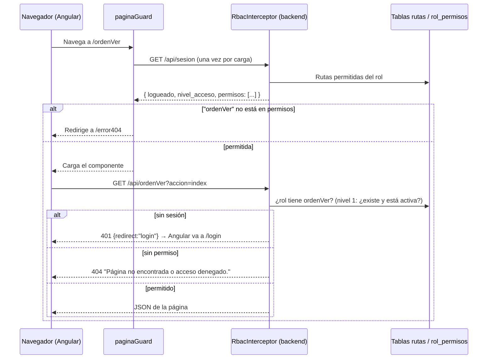

# 8. Permisos, roles y sesión

El acceso funciona igual que en `index.php` del PHP: **cada página es una fila de la tabla `rutas`** y cada rol ve solo las páginas que tiene en `rol_permisos`. El administrador (rol 1) ve todas las páginas activas. Si una página no está en `rutas`, nadie la puede abrir, ni siquiera el administrador.

## Roles

El rol de un usuario es `usuarios.nivel_acceso`, que apunta a `tipousuario.idTipoUsuario`.

| Rol | Nombre | Qué hace en la plataforma | Menú (`frontend/src/app/layout/menu.ts`) |
| --- | --- | --- | --- |
| 1 | SuperUsuario | Administración completa: catálogos, usuarios, programación, reportes, costos, importaciones | `ADMIN` |
| 2 | Auxiliar | Apoyo administrativo; ve lo que se le asigne en `rol_permisos` | `ADMIN` (solo muestra lo permitido) |
| 3 | Técnico | Marca entrada, ve su programación, atiende servicios, cronómetro, horas extra, parqueaderos, inventario propio | `TECNICO` |
| 4 | Prosegur | Cliente: consulta de reportes y servicios (oculta los meses recientes según `meses_restriccion_prosegur`) | `PROSEGUR` |
| 5 | Supervisor Motorizados | Panel en vivo, cronómetro de la flota, alertas logísticas, aprobación de horas extra | `SUPERVISOR` |

El menú se elige por rol en `menuPorRol()` y es una **lista fija por rol**: no se filtra con `rol_permisos` (igual que `navbar_menu.php` en PHP). Por eso, al dar o quitar una página a un rol, revise también su menú. La protección real no depende del menú: si un usuario abre una página sin permiso (desde el menú o escribiendo la URL), Angular lo envía a la página 404 y el backend responde 404 a cualquier llamada de esa página.

## Cómo se decide si alguien puede entrar



Piezas de código:

| Dónde | Qué hace |
| --- | --- |
| `backend/.../core/RbacInterceptor.java` | Se ejecuta antes de **todo** `/api/**`. Toma la primera parte de la URL como página. Deja pasar `sesion` y `logout`, responde 401 si no hay sesión (salvo páginas públicas) y 404 si el rol no tiene la página |
| `backend/.../core/Rbac.java` | Las consultas a `rutas` y `rol_permisos`; la lista `PAGINAS_PUBLICAS`; la excepción `herramientasCarga` |
| `backend/.../modulos/login/LoginController.java` | `/api/sesion` devuelve la sesión y la lista de páginas permitidas; `/api/login`, `/api/logout`, cambio y recuperación de contraseña |
| `frontend/src/app/core/auth.ts` | Guarda la sesión en una señal y expone `puede(pagina)` |
| `frontend/src/app/core/guards.ts` | `paginaGuard` (permiso por página), `authGuard`, `loginGuard` y el interceptor que manda a `/login` ante un 401 |

### Páginas públicas

Sin iniciar sesión solo se puede entrar a: `login`, `solicitarCodigo`, `enviarCodigo`, `resetPassword`, `procesarResetPassword`, `cambiarPassword`, `procesarCambioPassword`, `mensajeEnviado` y `error404` (constante `Rbac.PAGINAS_PUBLICAS`). Igual deben existir en `rutas`.

### Excepción: `herramientasCarga`

La página de cargas por CSV (antes `helps/*.php`) **no está en `rutas`**. `Rbac.controladorPara()` la permite solo a sesiones con `nivel_acceso = 1`, y `rutasPermitidas()` la agrega a la lista del administrador para que aparezca en su menú.

## Sesión

- Cookie `PHPSESSID_INEES`, `HttpOnly`, duración por defecto 8 horas (`SESSION_TIMEOUT`). La sesión vive en la memoria del servidor: **al reiniciar el backend todos deben volver a entrar**.
- Claves guardadas (las mismas de `$_SESSION` en PHP): `usuario_id`, `usuario_name`, `nivel_acceso`, `usuario_cargo`. Durante un cambio obligatorio de contraseña se usan `temp_user_id`, `temp_username` y `temp_nivel_acceso`.
- En el backend se leen con `req.sesion().usuarioId()`, `.nivel()`, `.nombre()`, `.cargo()` o `.get("clave")` (`core/Sesion.java`).

## Inicio de sesión

1. `POST /api/login` con usuario y contraseña. La contraseña se compara con `usuarios.password_hash` (bcrypt, compatible con los hashes creados por PHP).
2. Si el usuario tiene `forzar_cambio_pwd = 1`, queda en sesión temporal y se le envía a `cambiarPassword`; solo después de cambiarla obtiene la sesión normal.
3. Cada ingreso se registra en la tabla `login` (usuario, fecha, hora, IP) y actualiza `usuarios.ultimo_acceso`.
4. No hay bloqueo por intentos fallidos ni vencimiento automático de contraseñas: los parámetros `intentos_maximos`, `password_vigencia_dias` y `session_timeout_minutos` existen en la tabla `parametros`, pero ni el PHP ni Java los leen. La sesión expira según `SESSION_TIMEOUT` (ver [03-configuracion.md](03-configuracion.md)).
5. "Olvidé mi contraseña": `solicitarCodigo` envía un código por correo (tabla `password_reset`) y `resetPassword` lo valida. Requiere SMTP configurado.

## Dar o quitar acceso a una página

Por SQL (no hay pantalla de administración de permisos; la tabla `rol_permisos` es la fuente de verdad):

```sql
-- Ver qué roles tienen una página
SELECT r.nombre_ruta, rp.rol_id
FROM rutas r LEFT JOIN rol_permisos rp ON rp.ruta_id = r.id_ruta
WHERE r.nombre_ruta = 'reporteFacturacion';

-- Dar la página al rol 5 (Supervisor Motorizados)
INSERT INTO rol_permisos (rol_id, ruta_id)
SELECT 5, id_ruta FROM rutas WHERE nombre_ruta = 'reporteFacturacion';

-- Quitarla
DELETE rp FROM rol_permisos rp
JOIN rutas r ON r.id_ruta = rp.ruta_id
WHERE rp.rol_id = 5 AND r.nombre_ruta = 'reporteFacturacion';

-- Desactivar una página para todos (sin borrarla)
UPDATE rutas SET estado = 'inactivo' WHERE nombre_ruta = 'programacionMapa';
```

Los cambios aplican en la siguiente carga de página del usuario (Angular vuelve a pedir `/api/sesion`); no hace falta reiniciar el backend.

Para registrar una página **nueva** ver [10-manual-de-cambios.md → Agregar una página nueva](10-manual-de-cambios.md#1-agregar-una-página-nueva-completa).

> La columna `rutas.controlador_ruta` guarda la ruta del archivo PHP original. Java no la usa para nada más que verificar que la fila exista; se mantiene para que el PHP siga funcionando contra la misma base.

## Matriz de permisos

Generada desde la base de datos: 146 páginas registradas en `rutas`. ✔ = el rol tiene la página en `rol_permisos`; ★ = el rol 1 la ve por ser administrador aunque no tenga fila. Las páginas inactivas no las ve nadie.

| Página | Estado | 1 SuperUsuario | 2 Auxiliar | 3 Técnico | 4 Prosegur | 5 Supervisor Motorizados | Descripción |
| --- | --- | --- | --- | --- | --- | --- | --- |
| `asistencia` | activo | ★ |  |  |  | ✔ | Módulo encargado de Hacer las horas extra |
| `calificacionServicioCrear` | activo | ★ |  |  |  |  | Formulario de Creación de los Tipos de Calificación |
| `calificacionServicioEditar` | activo | ★ |  |  |  |  | Edita los Tipos de calificación en la Base de Datos |
| `calificacionServicioEliminar` | activo | ★ |  |  |  |  | Elimina Lógicamente los Tipos de Calificación |
| `calificacionServicioVer` | activo | ★ |  |  |  |  | Ver los Tipos de calificación que están en la base de datos |
| `cambiarPassword` | activo | ★ | ✔ |  |  |  | Cambio de clave |
| `clienteCrear` | activo | ★ |  |  |  |  | Formulario de Creación de Clientes |
| `clienteEditar` | activo | ★ |  |  |  |  | Edita los Clientes Registrados en la Base de Datos |
| `clienteEliminar` | activo | ★ |  |  |  |  | Elimina Lógicamente los Clientes |
| `clienteVer` | activo | ★ |  |  |  |  | Ver los Clientes que están en la base de datos |
| `controlRemisionCrear` | activo | ★ |  |  |  | ✔ | Formulario de las Remisiones |
| `controlRemisionEditar` | activo | ★ |  |  |  | ✔ | Edita las Remisiones de la Base de Datos |
| `controlRemisionEliminar` | activo | ★ |  |  |  | ✔ | Elimina Lógicamente las Remisiones |
| `controlRemisionVer` | activo | ★ |  |  |  | ✔ | Ver las Remisiones en la base de datos |
| `costosAdministrativosCrear` | activo | ★ |  |  |  |  | Módulo encargado de Crear los costos de la nomina Administrativa y los Costos Administrativos |
| `costosAdministrativosEditar` | activo | ★ |  |  |  |  | Módulo encargado de Editar los costos de las personas Administrativas |
| `costosAdministrativosVer` | activo | ★ |  |  |  |  | Módulo encargado de Ver los costos de las personas Administrativas |
| `costosCrear` | activo | ★ |  |  |  |  | Módulo encargado de Crear los costos de los Motorizados |
| `costosEditar` | activo | ★ |  |  |  |  | Módulo encargado de Editar los costos de los Motorizados |
| `costosVer` | activo | ★ |  |  |  |  | Módulo encargado de Ver los costos de los Motorizados |
| `cronometroAdmin` | activo | ★ |  |  |  | ✔ | Módulo encargado de Ver el Historial de los Cronometros SuperUsuario |
| `cronometroCrear` | activo | ★ |  | ✔ |  |  | Módulo encargado de Crear los Cronometros Parte Técnicos |
| `cronometroHistorial` | activo | ★ |  | ✔ |  |  | Módulo encargado de Ver el Historial de los Cronometros Parte Técnicos |
| `cronometroReportes` | activo | ★ |  |  |  | ✔ | Módulo encargado de ver los Reportes de los Técnicos en Tiempo Real |
| `delegacionCrear` | activo | ★ |  |  |  |  | Formulario de Creación de los Tipos de Delegación |
| `delegacionEditar` | activo | ★ |  |  |  |  | Edita los Tipos de delegación en la Base de Datos |
| `delegacionEliminar` | activo | ★ |  |  |  |  | Elimina Lógicamente los Tipos de Delegación |
| `delegacionVer` | activo | ★ |  |  |  |  | Ver los Tipos de delegación que están en la base de datos |
| `diasFestivosCrear` | activo | ★ |  |  |  |  | Formulario de los días Festivos |
| `diasFestivosEditar` | activo | ★ |  |  |  |  | Edita los días Festivos de la Base de Datos |
| `diasFestivosEliminar` | activo | ★ |  |  |  |  | Elimina Lógicamente los días Festivos |
| `diasFestivosVer` | activo | ★ |  |  |  |  | Ver los días festivos en la base de datos |
| `estadoMaquinaCrear` | activo | ★ |  |  |  |  | Formulario de Creación de los Tipos de Estado de Máquina |
| `estadoMaquinaEditar` | activo | ★ |  |  |  |  | Edita los Tipos de estado de Máquina en la Base de Datos |
| `estadoMaquinaEliminar` | activo | ★ |  |  |  |  | Elimina Lógicamente los Tipos de Estado de Máquina |
| `estadoMaquinaVer` | activo | ★ |  |  |  |  | Ver los Tipos de Estado de Máquina que están en la base de datos |
| `exportarExcel` | activo | ★ |  |  |  | ✔ | Modulo para exportar reporte de puntos |
| `generarReporte` | activo | ★ |  |  |  | ✔ | Generar el Reporte Ejecutivo |
| `geolocalizar` | activo | ★ |  |  |  |  | Módulo encargado de Hacer la Geolocalización de los puntos |
| `gestionDevolucion` | activo | ★ |  |  |  |  | Módulo encargado de Marcar los Repuestos Devueltos |
| `horaExtraAdmin` | activo | ★ |  |  |  | ✔ | Módulo encargado de Ver el Historial de las Horas Extra Administrador |
| `horaExtraCrear` | activo | ★ |  | ✔ |  |  | Módulo encargado de Crear las Horas Extra Técnicos |
| `horaExtraExcel` | activo | ★ |  |  |  | ✔ | Módulo encargado de Generar las Horas Extra en Formato Excel |
| `horaExtraGenerar` | activo | ★ |  |  |  | ✔ | Módulo encargado de Generar el PDF de los Reportes de las Horas Extra |
| `horaExtraHistorial` | activo | ★ |  | ✔ |  |  | Módulo encargado de Ver el Historial de las Horas Extra Técnicos |
| `importarEstadoMaquina` | activo | ★ |  |  |  |  | Módulo encargado de Importar estado de maquinas desde Excel |
| `importarExcel` | activo | ★ |  |  |  |  | Exportar Excel de Prosegur |
| `importarMunicipios` | activo | ★ |  |  |  |  | Modulo encargado de poder actualizar los puntos con la información del excel de la programación |
| `informacionBaseDatos` | activo | ★ |  |  |  |  | Móduo encargado de mostrar información relevante de la base de datos |
| `inicio` | activo | ★ | ✔ | ✔ | ✔ | ✔ | Dashboard Principal |
| `inventarioTecnicoCrear` | activo | ★ |  |  |  | ✔ | Formulario de el Inventario de Repuesto de Técnico |
| `inventarioTecnicoEditar` | activo | ★ |  |  |  | ✔ | Edita el Inventario de Repuestos de la Base de Datos |
| `inventarioTecnicoEliminar` | activo | ★ |  |  |  | ✔ | Elimina Lógicamente el inventario de Repuestos |
| `inventarioTecnicoVer` | activo | ★ |  | ✔ |  | ✔ | Ver inventario de Repuestos en la base de datos |
| `login` | activo | ★ | ✔ |  |  |  | Pantalla de Login |
| `logout` | activo | ★ |  |  |  |  | Cierre de sesión (Sin archivo físico, lógica interna) |
| `maquinaCrear` | activo | ★ |  |  |  |  | Formulario de las máquinas |
| `maquinaEditar` | activo | ★ |  |  |  |  | Edita las Máquinas de la Base de Datos |
| `maquinaEliminar` | activo | ★ |  |  |  |  | Elimina Lógicamente las Máquinas |
| `maquinaVer` | activo | ★ |  |  |  |  | Ver las Máquinas en la base de datos |
| `modalidadOperativaCrear` | activo | ★ |  |  |  |  | Formulario de Creación de las Modalidades Operativas |
| `modalidadOperativaEditar` | activo | ★ |  |  |  |  | Edita los Tipos de Modalidad Operativa en la Base de Datos |
| `modalidadOperativaEliminar` | activo | ★ |  |  |  |  | Elimina Lógicamente los Tipos de Modalidad Operativa |
| `modalidadOPerativaVer` | activo | ★ |  |  |  |  | Ver los Tipos de Estado de Modalidad Operativa que están en la base de datos |
| `notificacionesLogistica` | activo | ★ |  |  |  |  | Módulo encargado de Enviar las Notificaciones de la Logistica |
| `ordenCrear` | activo | ★ | ✔ |  |  |  | Creación de Órdenes |
| `ordenDetalle` | activo | ★ | ✔ |  |  | ✔ | Gestión de Órdenes |
| `ordenDetalleBuscar` | activo | ★ |  |  |  | ✔ | Vista encargada de Buscar los servicios uno a uno filtrados |
| `ordenMovil` | activo | ★ |  | ✔ |  |  | Módulo encargado de la Visualización de el historial de Servicios Para los Técnicos |
| `ordenReporte` | activo | ★ |  |  |  | ✔ | Genera el excel, de los clientes puntos device_id y otros elementos de la base de datos |
| `ordenVer` | activo | ★ | ✔ |  |  | ✔ | Datatable de las Órdenes Creadas |
| `panelSupervisor` | activo | ★ |  |  |  |  | Módulo encargado de Ver el Progreso de los Técnicos para el Supervisor |
| `parqueaderoAdmin` | activo | ★ |  | ✔ |  | ✔ | Módulo encargado de Ver los Parqueaderos por Parte del Administrador |
| `parqueaderoCrear` | activo | ★ |  | ✔ |  |  | Módulo encargado de Crear los Parqueaderos de los Técnicos |
| `parqueaderoHistorial` | activo | ★ |  | ✔ |  |  | Módulo encargado de Ver el Historial de los Parqueaderos Vista de los Técnicos |
| `pdfServicio` | activo | ★ |  |  | ✔ |  | Módulo encargado de Generar el Pdf de Cada Servicio |
| `planeacionVer` | activo | ★ |  |  |  |  | Módulo encargado de ver la planeación realizada para todos los técnicos |
| `procesarCambioPassword` | activo | ★ | ✔ |  |  |  | Acción de Cambiar Contraseña |
| `programacionConsolidado` | activo | ★ |  |  |  |  | Módulo encargado de ver la Programación antes de descargar el excel correspondiente. |
| `programacionCrear` | activo | ★ |  |  |  |  | Módulo encargado de Crear La Programación |
| `programacionMapa` | activo | ★ |  |  |  |  | Módulo encargado de Hacer la Programación desde el Mapa |
| `puntoCrear` | activo | ★ |  |  |  |  | Formulario de los Tipos de Puntos |
| `puntoEditar` | activo | ★ |  |  |  |  | Edita los Tipos de Puntos en la Base de Datos |
| `puntoEliminar` | activo | ★ |  |  |  |  | Elimina Lógicamente los Tipos de Puntos |
| `puntoVer` | activo | ★ |  |  |  |  | Ver los Tipos de puntos que están en la base de datos |
| `rastreoTecnico` | activo | ★ |  |  |  |  | Módulo encargado de Mostrar el Rastro de los Técnicos en el Mapa |
| `remisionesPendientes` | activo | ★ |  |  |  |  | Módulo encargado de mostrar las remisiones salteadas para poder hacerles el control |
| `reporteDevolucion` | activo | ★ |  |  |  |  | Módulo encargado de Generar el Reporte de las devoluciones |
| `reporteEjecutivo` | activo | ★ |  |  |  | ✔ | Ver el Reporte Ejecutivo |
| `reporteFacturacion` | activo | ★ |  |  |  |  | Módulo encargado de Hacer el Reporte de la Facturación |
| `reporteHistorial` | activo | ★ |  |  |  |  | Módulo encargado de Generar el Historial de los Servicios que se han generado en un intervalo de Tie |
| `reporteMaquinas` | activo | ★ |  |  |  |  | Módulo encargado de Mostrar el número de puntos de cada tipo de Máquina de la Base de Datos |
| `reporteRepuesto` | activo | ★ |  |  |  |  | Reporte de los repuestos usados durante el mes |
| `reporteRepuestos` | activo | ★ |  |  |  |  | Módulo encargado de Hacer el Reporte de los Repuestos PDF  |
| `reporteTarifas` | activo | ★ |  |  |  |  | Módulo encargado de Hacer el Reporte de las Tarifas de las Máquinas |
| `reporteTecnico` | activo | ★ |  | ✔ |  | ✔ | Reporte de los servicios hechos por tecnico |
| `reporteTrazabilidad` | activo | ★ |  |  |  |  | Módulo encargado de Trazabilidad de repuestos suministrados (Excel 2 hojas) |
| `repuestoCrear` | activo | ★ |  |  |  | ✔ | Formulario de Creación de Repuestos |
| `repuestoEditar` | activo | ★ |  |  |  | ✔ | Edita los Repuestos Registrados en la Base de Datos |
| `repuestoEliminar` | activo | ★ |  |  |  | ✔ | Elimina Lógicamente los Repuestos |
| `repuestoVer` | activo | ★ |  |  |  | ✔ | Ver los Repuestos que están en la base de datos |
| `resetPassword` | activo | ★ |  |  |  |  | Hace el Cambio de la Contraseña |
| `servicioEditar` | activo | ★ |  |  |  |  | Módulo encargado de completar la información de los servicios (provicionalmente) |
| `serviciosPdf` | activo | ★ |  |  | ✔ |  | Módulo encargado de poder ver los pdfs de los Servicios |
| `solicitarCodigo` | activo | ★ |  |  |  |  | Solicitar Código de Recuperación de Contraseña |
| `solicitarInventario` | activo | ★ |  | ✔ |  |  | Módulo encargado de Solicitar Repuestos por parte de los técnicos |
| `tarifaCrear` | activo | ★ |  |  |  |  | Formulario de los Tipos de Usuarios |
| `tarifaEditar` | activo | ★ |  |  |  |  | Edita los Tipos de Tarifas en la Base de Datos |
| `tarifaEliminar` | activo | ★ |  |  |  |  | Elimina Lógicamente los Tipos de Tarifas |
| `tarifaMasiva` | activo | ★ |  |  |  |  | Módulo encargado de realizar la edición Masiva de las Tarifas |
| `tarifaVer` | activo | ★ |  |  |  |  | Ver los Tipos de tarifas que están en la base de datos |
| `tecnicoCrear` | activo | ★ |  |  |  |  | Formulario de Tecnico |
| `tecnicoEditar` | activo | ★ |  |  |  |  | Edita los Tipos de Tecnico en la Base de Datos |
| `tecnicoEliminar` | activo | ★ |  |  |  |  | Elimina Lógicamente los Tipos de Técnicos |
| `tecnicoProgramacion` | activo | ★ |  | ✔ |  |  | Módulo encargado de poder ver la Programación de cada motorizado |
| `tecnicoReporte` | activo | ★ |  | ✔ |  |  | Módulo encargado de poder hacer el Reporte de Cada Téncnico |
| `tecnicoReporteEditar` | activo | ★ |  | ✔ |  |  | Módulo encargado de Editar los Reportes de los Técnicos |
| `tecnicoVer` | activo | ★ |  |  |  |  | Ver los Tipos de Estado de Modalidad Operativa que están en la base de datos |
| `tipoMantenimientoCrear` | activo | ★ |  |  |  |  | Formulario de Creación de los Tipos de Mantenimiento |
| `tipoMantenimientoEditar` | activo | ★ |  |  |  |  | Edita los Tipos de Mantenimiento Registrados en la Base de Datos |
| `tipoMantenimientoEliminar` | activo | ★ |  |  |  |  | Elimina Lógicamente los Tipos de Mantenimiento |
| `tipoMantenimientoVer` | activo | ★ |  |  |  |  | Ver los Tipos de Mantenimiento que están en la base de datos |
| `tipoMaquinaCrear` | activo | ★ |  |  |  |  | Formulario de Creación de los Tipos de Máquinas |
| `tipoMaquinaEditar` | activo | ★ |  |  |  |  | Edita los Tipos de Máquinas Registrados en la Base de Datos |
| `tipoMaquinaEliminar` | activo | ★ |  |  |  |  | Elimina Lógicamente los Tipos de Clientes |
| `tipoMaquinaVer` | activo | ★ |  |  |  |  | Ver los Tipos de Máquinas que están en la base de datos |
| `tipoNovedadCrear` | activo | ★ |  |  |  |  | Módulo encargado de Crear un Nuevo Tipo de Novedad |
| `tipoNovedadEditar` | activo | ★ |  |  |  |  | Módulo encargado de Editar los Tipos de Novedades |
| `tipoNovedadEliminar` | activo | ★ |  |  |  |  | Módulo encargado de Eliminar (Inactivar) los Tipos de Novedades |
| `tipoNovedadVer` | activo | ★ |  |  |  |  | Módulo encargado de Ver los Tipos de Novedades de la Base de Datos |
| `tipoUsuarioCrear` | activo | ★ |  |  |  |  | Formulario de los Tipos de Usuarios |
| `tipoUsuarioEditar` | activo | ★ |  |  |  |  | Edita los Tipos de Usuarios en la Base de Datos |
| `tipoUsuarioEliminar` | activo | ★ |  |  |  |  | Elimina Lógicamente los Tipos de Usuario |
| `tipoUsuarioVer` | activo | ★ |  |  |  |  | Ver los TIpos de Usuarios que están en la base de datos |
| `transporteCrear` | activo | ★ |  |  |  |  | Módulo encargado de Crear los Transportes |
| `transporteEditar` | activo | ★ |  |  |  |  | Módulo encargado de Editar los Transportes |
| `transportePdf` | activo | ★ |  |  |  |  | Módulo encargado de Generar el Pdf de los Transoprtes |
| `transporteVer` | activo | ★ |  |  |  |  | Módulo encargado de Ver los Transportes |
| `turno` | activo | ★ |  | ✔ |  |  | Marcar la entrada del turno del tecnico |
| `turnoExcel` | activo | ★ |  |  |  |  | Excel de entradas de turno |
| `turnoPdf` | activo | ★ |  |  |  |  | PDF de entradas de turno |
| `turnoReportes` | activo | ★ |  |  |  |  | Reporte de entradas de turno (Excel y PDF) |
| `usuarioCrear` | activo | ★ |  |  |  |  | Creación de los Usuarios |
| `usuarioEditar` | activo | ★ |  |  |  |  | Editar los Usuarios Registrados |
| `usuarioEliminar` | activo | ★ |  |  |  |  | Elimina lógicamente los Usuarios  |
| `usuarioVer` | activo | ★ |  |  |  |  | Ver los Usuarios Registrados |

> Para regenerar esta tabla: `powershell -ExecutionPolicy Bypass -File documentacion\herramientas\generar-permisos.ps1`.
