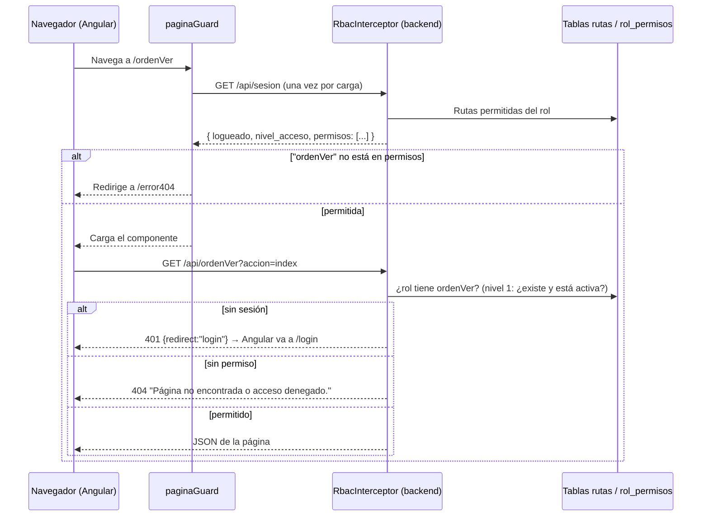

# 8. Permisos, roles y sesión

El acceso funciona igual que en `index.php` del PHP: **cada página es una fila de la tabla `rutas`** y cada rol ve solo las páginas que tiene en `rol_permisos`. El administrador (rol 1) ve todas las páginas activas. Si una página no está en `rutas`, nadie la puede abrir, ni siquiera el administrador.

## Roles

El rol de un usuario es `usuarios.nivel_acceso`, que apunta a `tipousuario.idTipoUsuario`.

| Rol | Nombre | Qué hace en la plataforma | Menú (`frontend/src/app/layout/menu.ts`) |
| --- | --- | --- | --- |
| 1 | SuperUsuario | Administración completa: catálogos, usuarios, programación, reportes, costos, importaciones | `ADMIN` |
| 2 | Auxiliar | Apoyo administrativo; ve lo que se le asigne en `rol_permisos` | `ADMIN` (solo muestra lo permitido) |
| 3 | Técnico | Marca entrada, ve su programación, atiende servicios, cronómetro, horas extra, parqueaderos, inventario propio | `TECNICO` |
| 4 | Prosegur | Cliente: consulta de reportes y servicios (oculta los meses recientes según `meses_restriccion_prosegur`) | `PROSEGUR` |
| 5 | Supervisor Motorizados | Panel en vivo, cronómetro de la flota, alertas logísticas, aprobación de horas extra | `SUPERVISOR` |

El menú se elige por rol en `menuPorRol()` y es una **lista fija por rol**: no se filtra con `rol_permisos` (igual que `navbar_menu.php` en PHP). Por eso, al dar o quitar una página a un rol, revise también su menú. La protección real no depende del menú: si un usuario abre una página sin permiso (desde el menú o escribiendo la URL), Angular lo envía a la página 404 y el backend responde 404 a cualquier llamada de esa página.

## Cómo se decide si alguien puede entrar



Piezas de código:

| Dónde | Qué hace |
| --- | --- |
| `backend/.../core/RbacInterceptor.java` | Se ejecuta antes de **todo** `/api/**`. Toma la primera parte de la URL como página. Deja pasar `sesion` y `logout`, responde 401 si no hay sesión (salvo páginas públicas) y 404 si el rol no tiene la página |
| `backend/.../core/Rbac.java` | Las consultas a `rutas` y `rol_permisos`; la lista `PAGINAS_PUBLICAS`; la excepción `herramientasCarga` |
| `backend/.../modulos/login/LoginController.java` | `/api/sesion` devuelve la sesión y la lista de páginas permitidas; `/api/login`, `/api/logout`, cambio y recuperación de contraseña |
| `frontend/src/app/core/auth.ts` | Guarda la sesión en una señal y expone `puede(pagina)` |
| `frontend/src/app/core/guards.ts` | `paginaGuard` (permiso por página), `authGuard`, `loginGuard` y el interceptor que manda a `/login` ante un 401 |

### Páginas públicas

Sin iniciar sesión solo se puede entrar a: `login`, `solicitarCodigo`, `enviarCodigo`, `resetPassword`, `procesarResetPassword`, `cambiarPassword`, `procesarCambioPassword`, `mensajeEnviado` y `error404` (constante `Rbac.PAGINAS_PUBLICAS`). Igual deben existir en `rutas`.

### Excepción: `herramientasCarga`

La página de cargas por CSV (antes `helps/*.php`) **no está en `rutas`**. `Rbac.controladorPara()` la permite solo a sesiones con `nivel_acceso = 1`, y `rutasPermitidas()` la agrega a la lista del administrador para que aparezca en su menú.

## Sesión

- Cookie `PHPSESSID_INEES`, `HttpOnly`, duración por defecto 8 horas (`SESSION_TIMEOUT`). La sesión vive en la memoria del servidor: **al reiniciar el backend todos deben volver a entrar**.
- Claves guardadas (las mismas de `$_SESSION` en PHP): `usuario_id`, `usuario_name`, `nivel_acceso`, `usuario_cargo`. Durante un cambio obligatorio de contraseña se usan `temp_user_id`, `temp_username` y `temp_nivel_acceso`.
- En el backend se leen con `req.sesion().usuarioId()`, `.nivel()`, `.nombre()`, `.cargo()` o `.get("clave")` (`core/Sesion.java`).

## Inicio de sesión

1. `POST /api/login` con usuario y contraseña. La contraseña se compara con `usuarios.password_hash` (bcrypt, compatible con los hashes creados por PHP).
2. Si el usuario tiene `forzar_cambio_pwd = 1`, queda en sesión temporal y se le envía a `cambiarPassword`; solo después de cambiarla obtiene la sesión normal.
3. Cada ingreso se registra en la tabla `login` (usuario, fecha, hora, IP) y actualiza `usuarios.ultimo_acceso`.
4. No hay bloqueo por intentos fallidos ni vencimiento automático de contraseñas: los parámetros `intentos_maximos`, `password_vigencia_dias` y `session_timeout_minutos` existen en la tabla `parametros`, pero ni el PHP ni Java los leen. La sesión expira según `SESSION_TIMEOUT` (ver [03-configuracion.md](03-configuracion.md)).
5. "Olvidé mi contraseña": `solicitarCodigo` envía un código por correo (tabla `password_reset`) y `resetPassword` lo valida. Requiere SMTP configurado.

## Dar o quitar acceso a una página

Por SQL (no hay pantalla de administración de permisos; la tabla `rol_permisos` es la fuente de verdad):

```sql
-- Ver qué roles tienen una página
SELECT r.nombre_ruta, rp.rol_id
FROM rutas r LEFT JOIN rol_permisos rp ON rp.ruta_id = r.id_ruta
WHERE r.nombre_ruta = 'reporteFacturacion';

-- Dar la página al rol 5 (Supervisor Motorizados)
INSERT INTO rol_permisos (rol_id, ruta_id)
SELECT 5, id_ruta FROM rutas WHERE nombre_ruta = 'reporteFacturacion';

-- Quitarla
DELETE rp FROM rol_permisos rp
JOIN rutas r ON r.id_ruta = rp.ruta_id
WHERE rp.rol_id = 5 AND r.nombre_ruta = 'reporteFacturacion';

-- Desactivar una página para todos (sin borrarla)
UPDATE rutas SET estado = 'inactivo' WHERE nombre_ruta = 'programacionMapa';
```

Los cambios aplican en la siguiente carga de página del usuario (Angular vuelve a pedir `/api/sesion`); no hace falta reiniciar el backend.

Para registrar una página **nueva** ver [10-manual-de-cambios.md → Agregar una página nueva](10-manual-de-cambios.md#1-agregar-una-página-nueva-completa).

> La columna `rutas.controlador_ruta` guarda la ruta del archivo PHP original. Java no la usa para nada más que verificar que la fila exista; se mantiene para que el PHP siga funcionando contra la misma base.
